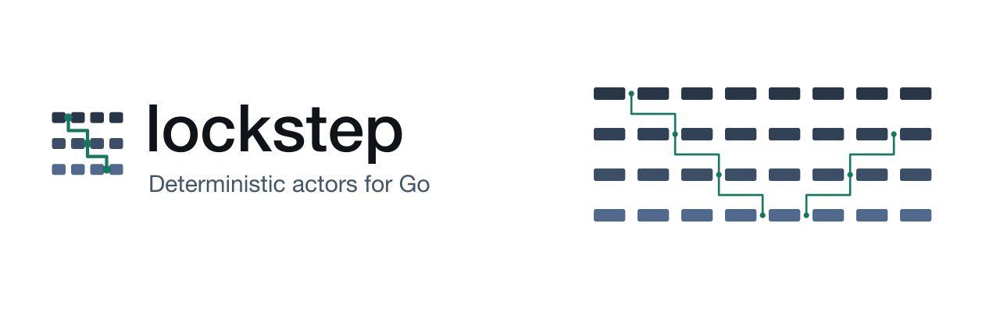

[](https://github.com/hmdsefi/lockstep/actions/workflows/build.yml?query=branch%3Amain)
[](https://pkg.go.dev/github.com/hmdsefi/lockstep)
[](https://github.com/hmdsefi/lockstep/releases/latest)
[](LICENSE)
[](https://github.com/hmdsefi/lockstep)

<p align="center">
  <picture>
    <source media="(prefers-color-scheme: dark)" srcset=".github/assets/readme-dark.svg">
    
  </picture>
</p>

<p align="center"><strong>Write actors. Get exact replay.</strong></p>

lockstep is an actor framework for Go with deterministic simulation testing (DST) built in. You
write typed actors with mailboxes, supervision, timers, and request and reply. The same actor code
runs in your program on `lockstep.New()`, and in `go test` on a seeded simulation that partitions
the network, drops and delays messages, and crashes and restarts nodes. Any failure in the
simulation replays exactly from its seed, so a bug that depends on timing becomes one command you
can rerun.

The actor model here is the one Erlang/OTP and Akka made familiar, and that Go libraries such as
protoactor-go, Hollywood, Ergo, and GoAkt also use. lockstep's runtime owns every message
delivery, timer, and I/O event, and that is what makes the simulation exact.

## Features

lockstep includes:

- **Typed actors and PIDs.** `Actor[M]` receives one message type and `PID[M]` accepts only that
  type, so a message of the wrong type does not compile.
- **Request and reply.** `Ask` with a typed `ReplyTo`, timeouts, and `Pipe`, which delivers the
  reply as a message instead of blocking the actor.
- **Bounded mailboxes** with an explicit policy when full: fail the send, drop the newest or
  oldest message, or block the sender.
- **Supervision trees** in the Erlang style: one-for-one and all-for-one strategies, restart
  limits with backoff, death watch, an actor cap, and a `Stopped` hook on every stop and restart.
- **Timers and effects** on the runtime's clock: `ctx.After`, `ctx.Every`, and I/O as named
  effects with `lockstep.Do`.
- **A pooled production engine.** `lockstep.New()` runs actors on a fixed pool of worker
  goroutines, so turns of different actors run in parallel while each actor handles one message at
  a time.
- **Overload protection** in the production engine: new actors and user messages are refused while
  the live heap is near its memory limit, a turn that runs too long is reported and its actor
  isolated, and a growing goroutine count is logged.
- **Event-sourced persistent actors.** `persist.Spawn` starts an actor whose state is rebuilt from a
  journal of events. A reply sent from a `Then` callback goes out only after its events are fsynced,
  and a restart recovers from the newest snapshot and the events after it. `persist/filestore` is
  the reference journal and snapshot store. The same actor code runs on the operating system's files
  in production and on a simulated disk in tests, where crashes, torn writes, and failed syncs
  exercise the real recovery code.
- **Deterministic simulation testing** in `lockstep/sim`, built on
  [faultline](https://github.com/hmdsefi/faultline): multiple nodes, network partitions, message
  drops and delays, crashes and restarts, memory pressure, and exact replay from a seed.
- **Deadlock and leak detection** in simulation. A cycle of pending asks fails the seed with
  `lockstep: deadlock: A → B → A`. An actor that stops with an effect pending, a resource unclosed,
  or a file still open on the simulated disk fails it with a leak failure.
- **A static analyzer**, `lockstep-vet`, also available as a golangci-lint plugin. It reports
  `time.Now`, global randomness, goroutines, `select`, map ranges, and blocking calls in actor
  code, and it reports messages that share memory with their sender, actors that share state,
  ignored replies and errors, unhandled message types, and resources an actor never releases.
- **A Raft example** with three planted bugs that a seeded partition or crash exposes.

## Install

lockstep needs Go 1.26 or later:

```sh
go version
go get github.com/hmdsefi/lockstep@v0.1.0
```

## Quick start: a first actor

An actor is a type with a `Receive` method for one message type. The following program is a
counter: `Add` messages change its total, and a `Get` message asks for it.

```go
package main

import (
	"context"
	"fmt"
	"log"

	"github.com/hmdsefi/lockstep"
)

// Msg is every message the counter accepts.
type Msg interface{ isMsg() }

// Add adds N to the total.
type Add struct{ N int }

// Get asks for the total.
type Get struct{ Reply lockstep.ReplyTo[int] }

func (Add) isMsg() {}
func (Get) isMsg() {}

// Counter is an actor that keeps a running total.
type Counter struct{ total int }

func (c *Counter) Receive(ctx *lockstep.Context[Msg], msg Msg) {
	switch m := msg.(type) {
	case Add:
		c.total += m.N
	case Get:
		m.Reply.Send(ctx, c.total)
	}
}

func newCounter() lockstep.Actor[Msg] { return &Counter{} }

func getTotal(r lockstep.ReplyTo[int]) Msg { return Get{Reply: r} }

func main() {
	sys := lockstep.New()
	counter, err := lockstep.Spawn(sys, "counter", newCounter)
	if err != nil {
		log.Fatal(err)
	}
	for _, n := range []int{1, 2, 3} {
		if err := lockstep.Send[Msg](sys, counter, Add{N: n}); err != nil {
			log.Fatal(err)
		}
	}
	total, err := lockstep.Ask(sys, counter, getTotal).Await(context.Background())
	if err != nil {
		log.Fatal(err)
	}
	fmt.Println("total:", total)

	if err := sys.Shutdown(context.Background()); err != nil {
		log.Fatal(err)
	}
}
```

```sh
go run .
```

```text
total: 6
```

`Spawn` returns a `PID[Msg]`, so the compiler rejects a message of the wrong type. `Send` takes
`[Msg]` explicitly because `Add{N: n}` alone has type `Add`. `Ask` puts a `ReplyTo[int]` into the
`Get` message and returns a `*Reply[int]`. `Await` blocks, so call it outside actors; inside an
actor, `lockstep.Pipe` delivers the reply as a message instead.

## Configure the production engine

`lockstep.New()` runs actor turns on a fixed pool of worker goroutines. Turns of different actors
run in parallel, the turns of one actor never overlap, and messages from one sender to one
receiver arrive in send order. Timers and effect results run on the same workers. Four options
configure the engine:

- `WithWorkers(n)` sets the number of workers. The default is `runtime.GOMAXPROCS(0)`, read when
  `New` runs.
- `WithThroughput(n)` sets how many user messages an actor processes in one turn before it yields
  its worker to other actors. The default is 32.
- `WithActorThroughput(n)` is a `Spawn` option that replaces that limit for one actor, for example
  a small `n` for an actor whose messages are expensive.
- `WithEffectPool(workers, queue)` bounds effects started with `lockstep.Do`: at most `workers`
  run at once, and at most `queue` more wait for a free slot. The defaults are 64 and 1024. A `Do`
  call that finds both full resolves with `ErrOverloaded`.

The quick start's `main` can begin like this instead:

```go
sys := lockstep.New(
	lockstep.WithWorkers(4),
	lockstep.WithThroughput(64),
	lockstep.WithEffectPool(16, 256),
)
counter, err := lockstep.Spawn(sys, "counter", newCounter, lockstep.WithActorThroughput(256))
if err != nil {
	log.Fatal(err)
}
```

The options apply only to `lockstep.New()`. Simulation checks the values and then ignores them:
every turn there processes one message, in an order the seed decides.

## Protect the production engine from overload

`lockstep.New()` stops accepting new actors and user messages while the live heap is near its
limit, reports a turn that runs too long, and warns when the process has too many goroutines. Three
options tune this, and each has a default:

- `WithAdmission(high, low)` sets the memory thresholds in bytes.
- `WithWatchdog(d)` sets how long a turn may run before it counts as stuck.
- `WithGoroutineWarning(n)` sets the goroutine count that triggers a warning.

```go
sys := lockstep.New(
	lockstep.WithAdmission(768<<20, 640<<20),
	lockstep.WithWatchdog(2*time.Second),
	lockstep.WithGoroutineWarning(50_000),
)
```

### Memory admission

`New` samples the live heap before it returns and then every 100 ms. Without `WithAdmission`, the
thresholds follow the Go memory limit (`debug.SetMemoryLimit` or `GOMEMLIMIT`): admission stops
when the heap reaches 90% of the limit and resumes when it falls to 80%. With no memory limit set,
memory never refuses work. `WithAdmission(high, low)` replaces the limit with absolute byte
thresholds and needs `0 < low < high`. `WithAdmission(0, 0)` turns memory admission off, even when
a limit is set.

While admission is stopped:

- `Spawn` returns an error that matches `ErrOverloaded`. Restarts of existing actors are not
  refused.
- Each `Send` and `Ask` to a user actor is treated as if the target's mailbox were full, so the
  mailbox policy decides. Under `FailSend`, the error matches both `ErrOverloaded` and
  `ErrMailboxFull`. System messages, replies, timer messages, and effect results are not refused.
- Actors that called `ctx.SubscribeOverload` receive an `Overloaded` signal when admission stops
  and another when it resumes.

The system logs the change: `admission refusing` at Warn when it stops and `admission resumed` at
Info when it resumes.

### Stuck turns

A turn that never returns holds its worker, and the actor behind it stops answering. One watchdog
goroutine reports every turn that has run for at least the timeout. The default,
`DefaultWatchdogTimeout`, is 5 seconds, and `WithWatchdog(0)` turns the watchdog off.

The report is one log line at Error with the actor's path and the stack of the worker goroutine
that runs the turn. From then until the turn returns, the actor counts as stuck. User messages to
it get its mailbox policy as if the mailbox were full, and under `FailSend` the error matches
`ErrMailboxFull`. System messages, such as `Stop`, still queue, and a `Stop` that queued while the
turn was stuck stops the actor after the turn returns, without a restart. Otherwise, when the turn
returns, the incarnation fails with an error that matches `ErrTimeout`, and its supervisor decides
whether to restart, stop, or escalate.

lockstep cannot preempt a turn. A turn that never returns keeps its worker, and `Shutdown` with a
deadline returns the context's error when the deadline passes.

### Goroutine count

Once a second, the system counts the goroutines of the whole process, not only lockstep's. When the
count reaches the bound from `WithGoroutineWarning(n)`, the system logs one warning at Warn with
the count and a summary of the ten functions that hold the most goroutines. The default,
`DefaultGoroutineWarning`, is 10,000, and `WithGoroutineWarning(0)` turns the warning off. After a
warning, the next one waits until the count falls below 80% of the bound and reaches it again.

### Logs and invalid values

These events go to the logger that `slog.Default()` returned when `New` ran, each with a `node`
attribute, so set the default logger before you call `New`. A negative watchdog timeout or goroutine
bound, or a non-zero `WithAdmission` pair other than `0 < low < high`, makes `New` panic with an
error that wraps `ErrInvalidOption`.

Simulation checks these values and then ignores them. It stays deterministic, and overload there
comes from `sim.Options.Budget` and `s.Pressure`, described in
[Architecture](docs/architecture.md#overload). The actor cap, `WithMaxActors`, applies in both
engines.

## Deterministic simulation testing: the same actor under faults

`sim.Simulate` runs a test body once per seed. Each run is a simulated world with virtual time
and a simulated network. The following test runs the counter on server node `n1`, sends 20 `Add`
messages from client node `c1`, and lets faultline crash and restart `n1` at random times. A
final check runs when the run ends:

```go
package main

import (
	"fmt"
	"testing"
	"time"

	"github.com/hmdsefi/faultline"
	"github.com/hmdsefi/faultline/kernel/fault"
	"github.com/hmdsefi/lockstep"
	"github.com/hmdsefi/lockstep/sim"
)

func TestCounter(t *testing.T) {
	opts := sim.Options{Options: faultline.Options{Seeds: 50, Duration: 10 * time.Second}}
	sim.Simulate(t, opts, func(s *sim.Sim) {
		w := s.World()
		var counter lockstep.PID[Msg]
		s.Node("n1", func(sys *lockstep.System) {
			counter, _ = lockstep.Spawn(sys, "counter", newCounter)
		})
		s.Client("c1", func(*lockstep.System) {})
		w.Plan(&fault.Random{MaxDown: 1, Rules: []fault.Rule{
			{Kind: fault.KindCrash, Every: 8 * time.Second, MaxFor: time.Second},
		}})

		for range 20 {
			w.RunFor(250 * time.Millisecond)
			if err := sim.Send[Msg](s, "c1", counter, Add{N: 1}); err != nil {
				w.T().Fatal(err)
			}
		}
		w.RunFor(4 * time.Second) // faults stop at 7.5s, a quarter before the end
		total, err := sim.Ask(s, "c1", counter, getTotal)
		w.Final("every add counted", func() error {
			if err != nil {
				return err
			}
			if total != 20 {
				return fmt.Errorf("total is %d after 20 adds", total)
			}
			return nil
		})
	})
}
```

The test imports faultline directly, so add it to `go.mod` and run the test:

```sh
go mod tidy
go test .
```

```text
--- FAIL: TestCounter (0.01s)
    counter_test.go:16: faultline: running 50 seeds from base 0x64b5629963419063 (test name)
    --- FAIL: TestCounter/seed=0x870af07a512d3866 (0.01s)
        faultline: final check "every add counted" failed after the run at t=10.000000000s
          total is 0 after 20 adds
        replay:    FAULTLINE_SEED=0x870af07a512d3866 go test -v -run '^TestCounter$' example.com/counter
        artifacts: $TMPDIR/faultline-501/example.com_counter/TestCounter/870af07a512d3866/
    counter_test.go:16: faultline: stopping after failing seed 0x870af07a512d3866; 48 of 50 seeds not run (set Options.KeepGoing to run all)
FAIL
FAIL	example.com/counter	0.330s
FAIL
```

The first seed passes and the second fails. The counter keeps its total in memory, so a crash
loses it. The run's `schedule.json` artifact shows when: `n1` crashed at t=4.87s, after 19 adds,
and restarted at t=5.71s with a new counter. The 20th add reached a node that was down.

The seeds come from the test's name, so they are the same on every machine. The `replay` line is
the command that runs the failing seed again:

```sh
FAULTLINE_SEED=0x870af07a512d3866 go test -v -run '^TestCounter$' example.com/counter
```

```text
=== RUN   TestCounter
    counter_test.go:16: faultline: FAULTLINE_SEED=0x870af07a512d3866: running 1 seed
=== RUN   TestCounter/seed=0x870af07a512d3866
    faultline: final check "every add counted" failed after the run at t=10.000000000s
      total is 0 after 20 adds
    replay:    FAULTLINE_SEED=0x870af07a512d3866 go test -v -run '^TestCounter$' example.com/counter
    artifacts: $TMPDIR/faultline-501/example.com_counter/TestCounter/870af07a512d3866/
--- FAIL: TestCounter (0.01s)
    --- FAIL: TestCounter/seed=0x870af07a512d3866 (0.01s)
FAIL
FAIL	example.com/counter	0.250s
FAIL
```

The replay fails the same check at the same virtual time, and its `report.json` holds the same
trace hash (a hash of every event in the run) as the first run: `0x56d752b8033ec3c3`. faultline
writes the artifacts under `os.TempDir()`, shown here as `$TMPDIR`; they include `trace.jsonl`,
`timeline.txt`, and a self-contained `timeline.html`.

Besides the checks you register, `sim` fails a seed when actors deadlock on each other's asks
(`lockstep: deadlock: A → B → A`), when an effect has no handler, and when an actor stops or
restarts with an effect still pending, a resource it owns failing to close, or a file it opened on
the simulated disk still open.

## Persistent actors: state that survives a restart

An event-sourced actor stores the events that produced its state. `persist.Spawn` starts one under
a persistence ID, the name of its stream of events. A command handler returns events. lockstep
writes them to a journal, calls fsync, and only then applies them to the state and runs the
callbacks you registered with `ctx.Then`, so a reply sent from a callback tells the caller that the
events are on disk. When the actor starts or restarts, it recovers its state from the newest
snapshot and the events after it.

The following program is a bank account. A `Deposit` stores a `Deposited` event and replies with
the new balance:

```go
package main

import (
	"context"
	"fmt"
	"log"

	"github.com/hmdsefi/lockstep"
	"github.com/hmdsefi/lockstep/persist"
	"github.com/hmdsefi/lockstep/persist/filestore"
)

// Deposit adds Amount to the account and replies with the new balance.
type Deposit struct {
	Amount int64
	Reply  lockstep.ReplyTo[int64]
}

// Deposited is the event that a Deposit stores.
type Deposited struct{ Amount int64 }

// Account is an event-sourced actor whose state is its balance.
type Account struct{}

func (Account) Initial() int64 { return 0 }

func (Account) Handle(ctx *persist.Context[Deposit, Deposited, int64], _ int64, d Deposit) []Deposited {
	ctx.Then(func(ctx *persist.Context[Deposit, Deposited, int64], balance int64) {
		d.Reply.Send(ctx, balance) // runs after the event is committed
	})
	return []Deposited{{Amount: d.Amount}}
}

func (Account) Apply(balance int64, e Deposited) int64 { return balance + e.Amount }

func newAccount() persist.EventSourced[Deposit, Deposited, int64] { return Account{} }

func deposit(amount int64) func(lockstep.ReplyTo[int64]) Deposit {
	return func(r lockstep.ReplyTo[int64]) Deposit { return Deposit{Amount: amount, Reply: r} }
}

func main() {
	store, err := filestore.Open("data")
	if err != nil {
		log.Fatal(err)
	}
	sys := lockstep.New()
	account, err := persist.Spawn(sys, "account", "acct-1", newAccount, persist.Config[Deposited, int64]{
		Journal: store,
		Events:  persist.JSON[Deposited](),
	})
	if err != nil {
		log.Fatal(err)
	}
	balance, err := lockstep.Ask(sys, account, deposit(5)).Await(context.Background())
	if err != nil {
		log.Fatal(err)
	}
	fmt.Println("balance:", balance)

	if err := sys.Shutdown(context.Background()); err != nil {
		log.Fatal(err)
	}
}
```

Run it twice:

```sh
go run .
go run .
```

```text
balance: 5
balance: 10
```

The first run creates the directory `data`. The second run starts a new system on the same
directory and recovers the balance of 5 from the journal before it handles the new deposit.

`Initial` returns the state before the first event, `Handle` turns a command into events, and
`Apply` folds one event into the state. `Apply` must be a pure function of its arguments, because
recovery calls it again for every stored event. An actor handles one command at a time, and while
it recovers and while a batch of events is being committed, its commands wait in the mailbox. The
actor's message type is the command type, so `Send` and `Ask` reach it like any actor.
`persist.JSON` encodes events with `encoding/json`. Any `persist.Codec` works whose `Encode` is
deterministic and returns a slice it does not reuse afterwards.

To start recovery from a snapshot instead of from the first event, give the `Config` a snapshot
store and a codec for the state. A `*filestore.Store` is both the journal and the snapshot store:

```go
persist.Config[Deposited, int64]{
	Journal:       store,
	Events:        persist.JSON[Deposited](),
	Snapshots:     store,
	State:         persist.JSON[int64](),
	SnapshotEvery: 100,
	PruneEvents:   true,
}
```

The actor saves a snapshot after every 100 committed events, beside its commands. With
`PruneEvents`, it deletes the events that an older snapshot covers. The newest two snapshots and the
events after the older one stay, so a damaged newest snapshot falls back to the older one.

A failed write or commit fails the actor, with an error that wraps the store's error, and its
supervisor decides what happens next. No reply goes out for events that did not commit, and a
restart recovers the state from what the store holds.

### The same actor on a simulated disk

`filestore.Open` uses the operating system's files. In a simulation, `s.Volume("n1")` returns the
simulated disk of node `n1` as a `filestore.FS`, and `filestore.New` runs a store on it. The disk
is faultline's: it keeps what was synced when the node crashes, and `Options.Disk` chooses what a
crash does to writes that were not synced (lose them, keep some, or tear one) and what a failed
sync does to pending writes, sets the capacity, and adds latency. A planner makes syncs fail. The
following test crashes and restarts `n1` while `c1` deposits 1, 20 times, and checks that no
acknowledged deposit is lost. It adds to the program above, and like the first test it imports
faultline directly:

```go
package main

import (
	"fmt"
	"testing"
	"time"

	"github.com/hmdsefi/faultline"
	"github.com/hmdsefi/faultline/kernel/fault"
	"github.com/hmdsefi/faultline/kernel/simdisk"
	"github.com/hmdsefi/lockstep"
	"github.com/hmdsefi/lockstep/persist"
	"github.com/hmdsefi/lockstep/persist/filestore"
	"github.com/hmdsefi/lockstep/sim"
)

func TestAccount(t *testing.T) {
	opts := sim.Options{Options: faultline.Options{Seeds: 50, Duration: 20 * time.Second}}
	opts.Disk.Latency = simdisk.DefaultLatency()
	sim.Simulate(t, opts, func(s *sim.Sim) {
		w := s.World()
		var account lockstep.PID[Deposit]
		s.Node("n1", func(sys *lockstep.System) {
			store := filestore.New(s.Volume("n1"))
			account, _ = persist.Spawn(sys, "account", "acct-1", newAccount, persist.Config[Deposited, int64]{
				Journal: store,
				Events:  persist.JSON[Deposited](),
			})
		})
		s.Client("c1", func(*lockstep.System) {})
		w.Plan(&fault.Random{MaxDown: 1, Rules: []fault.Rule{
			{Kind: fault.KindCrash, Every: 4 * time.Second, MaxFor: time.Second},
		}})

		var acked int64
		for range 20 {
			w.RunFor(250 * time.Millisecond)
			if _, err := sim.Ask(s, "c1", account, deposit(1), lockstep.WithTimeout(500*time.Millisecond)); err == nil {
				acked++
			}
		}
		w.RunFor(10 * time.Second) // faults stop at 15s, a quarter before the end
		balance, err := sim.Ask(s, "c1", account, deposit(0))
		w.Final("no acknowledged deposit is lost", func() error {
			if err != nil {
				return err
			}
			if balance < acked {
				return fmt.Errorf("balance %d after %d acknowledged deposits", balance, acked)
			}
			return nil
		})
	})
}
```

The recovery that runs after every crash is the code that runs in production, on a disk that lost
or tore the writes that were not synced. A store that acknowledged a deposit before its fsync could
lose it in a crash, and the check would fail on the seed that finds it.

A `Volume` belongs to its node. Using it from another node, or from outside a node event, fails the
seed with `lockstep/misuse`, and a file that an actor leaves open when it stops or restarts fails
it with `lockstep/leak`. A `Store` closes every file before a call returns, so only code that opens
files itself can leak one. [Architecture](docs/architecture.md#persistence) describes the journal
format, the fsync order, and how recovery tells a torn write from corruption.

## Static analysis: lockstep-vet and golangci-lint

A replay is exact only if actor code takes time, randomness, and I/O from the runtime, and actors
share nothing but messages. `lockstep-vet` runs nine analyzers, which report ten check codes:

- `LS100`: nondeterminism and blocking in actor code, such as `time.Now`, global `math/rand`,
  `crypto/rand`, a `go` statement, `select`, a range over a map, environment variables, channel
  operations, locks, and blocking network, file, database, or process calls.
- `LS110`: `Reply.Await` in actor code, which blocks the actor; use `lockstep.Pipe` instead.
- `LS200`: a variable used after it was sent. Once `lockstep.Send`, `lockstep.Ask`, or
  `ReplyTo.Send` returns, the receiver owns the slice, map, or pointer in the message, so the
  sender must copy it before sending or stop using it. `lockstep-vet` reports a use that the
  function's control flow can reach after the send, and only a use of the part that was sent:
  sending `s.items` and then reading `s.count` is fine. Assigning the variable again ends the
  tracking, unless the message holds the variable's own storage, such as its address or a slice of
  an array variable, where the assignment overwrites what was sent and is reported. On the branch
  where `lockstep.Send` returned an error, nothing was delivered, so the sender may keep using
  the message, for example to retry. A message type marked `//lockstep:immutable` is safe to send
  and keep.
- `LS201`: a type marked `//lockstep:immutable` that isn't. A field may hold basic values,
  `error`, `time.Time`, `lockstep.PID`, `lockstep.Address`, `lockstep.ReplyTo`, other immutable
  types and pointers to them, and arrays, slices, maps, and structs of those. Any other pointer,
  a channel, a function, an interface, a type parameter, and `unsafe.Pointer` are reported. No
  code may write into a slice or map field of the type or assign through a pointer to it, except
  to build a new value: writes to a local variable that the function initializes from `T{...}`,
  `&T{...}`, or `new(T)` and assigns nothing else are construction.
- `LS210`: shared mutable state. Actor code that writes a package variable is reported, and so is
  actor code that places the actor itself, a field that holds references, the address of a field,
  or a `*lockstep.Context` in a message. A field whose type is marked `//lockstep:immutable` may
  go in a message.
- `LS220`: the reply of `lockstep.Ask` that is never awaited or piped, and the error of
  `lockstep.Send` or `lockstep.Spawn` that is ignored.
- `LS230`: a message type with no case in `Receive`. When the actor's message type is an interface
  with an unexported method, every type of its package that implements it needs a case. So does
  every type the actor sends to itself through `ctx.After`, `ctx.Every`, `lockstep.Do`, or
  `lockstep.Pipe`. A case is a type in a type switch or a type assertion on the message.
- `LS240`: an actor field that holds a resource and is neither passed to `ctx.Own` nor released in
  `Stopped`. A resource is a field whose type implements `io.Closer`, a `*time.Timer` or
  `*time.Ticker`, or a type marked `//lockstep:resource`. A marked type with no `Close`, `Stop`,
  or `Release` method is reported too. A field holding a resource the actor does not own, such as
  a shared `*sql.DB`, takes `//lockstep:allow LS240 <reason>` in its doc comment.
- `LS001` and `LS002`: malformed and unknown `//lockstep:` directives.

`LS100`, `LS110`, `LS210`, `LS230`, and `LS240` look at actor code, except that `LS240` also
reports a `//lockstep:resource` type with no release method wherever the type is declared. `LS200`,
`LS201`, and `LS220` look at every function, because messages are sent, and immutable types
written, from any function.

The markers `//lockstep:immutable` and `//lockstep:resource` go in the doc comment of a type
declaration. A marker on an alias is misplaced, and `//lockstep:immutable` cannot mark an
interface type. They work across packages: a type marked in one package is immutable or a
resource in every package that imports it.

Install it and run it through `go vet`:

```sh
go install github.com/hmdsefi/lockstep/analysis/cmd/lockstep-vet@v0.1.0
go vet -vettool=$(which lockstep-vet) ./...
```

On the counter it prints nothing. If `Receive` also recorded `time.Now()` on every `Add` and
waited on an ask with `Await`, it would print:

```text
main.go:37:50: LS110: Reply.Await blocks the actor; use lockstep.Pipe to receive the reply as a message (actor code: (*Counter).Receive)
main.go:34:17: LS100: time.Now uses the wall clock; use ctx.Now, ctx.After or ctx.Every (actor code: (*Counter).Receive)
```

To accept one finding, add `//lockstep:allow LS100 <reason>` on the reported line, on the line
above it, or in the doc comment of the enclosing declaration. The reason is required, and one
directive can name several checks, as in `//lockstep:allow LS200,LS210 <reason>`. `LS001` and
`LS002` can't be suppressed.

The same checks run in golangci-lint as the module plugin `lockstep`. Build a custom binary with
this `.custom-gcl.yml`:

```yaml
version: v2.14.0
plugins:
  - module: github.com/hmdsefi/lockstep/analysis
    import: github.com/hmdsefi/lockstep/analysis/golangci
    version: v0.1.0
```

Enable the linter in `.golangci.yml`:

```yaml
version: "2"
linters:
  enable:
    - lockstep
  settings:
    custom:
      lockstep:
        type: module
```

Then run `golangci-lint custom` and `./custom-gcl run ./...`. golangci-lint's
[module plugin guide](https://golangci-lint.run/docs/plugins/module-plugins/) describes both files.

## Example: Raft under partitions and crashes

[`examples/raft`](examples/raft/README.md) is a Raft cluster written as lockstep actors. It runs
three or five servers and their clients through partitions, crashes, paused servers, and lossy
links, checks Raft's safety properties after every event, and replays any failing seed exactly.
Three planted bugs show what a failing seed looks like.

## Example: retries and cancellations

lockstep delivers each message at most once, in send order between one sender and one receiver,
and never retries. [Message delivery](docs/delivery.md) explains what your actors must handle
themselves: a retried request that arrives twice, and a Cancel that arrives before its Create.
[`examples/orders`](examples/orders/README.md) is an order service whose simulation tests find
both bugs from a seed and pin the fixes.

## Why the name "lockstep"

**Marching in lockstep** means moving in exact unison, every step identical.
That's the promise: every run with the same seed is identical.

The name also comes from **deterministic lockstep**, a game-networking technique
used by real-time strategy games such as *Age of Empires* and *StarCraft*. Instead
of sending game state over the network, every machine starts from the same state,
applies the same inputs in the same order, and runs a deterministic simulation,
so every machine computes the same game.

lockstep's simulation mode has the same properties:

| Deterministic lockstep (games) | lockstep (this project) |
|---|---|
| Same inputs, same order → same game state | Same seed → same message order → same system state |
| A replay file is tiny: only the inputs | A failing test comes down to a single seed |
| A *desync* means nondeterminism leaked in (floats, random numbers) | A divergence means nondeterminism leaked into an actor (`time.Now`, `math/rand`, a raw goroutine) |
| The engine must own every source of randomness | The runtime must own every scheduling, time, and I/O decision |

**What it doesn't mean:** in games, lockstep peers wait for each other every tick.
lockstep is **not** a game-sync library, and outside simulation it does not run in
lockstep: no actor waits for another, and turns follow the order in which messages
arrive. The lockstep behavior applies to **simulation mode**, where a single seeded
scheduler steps every actor in a fixed, replayable order.

## lockstep and faultline

lockstep's simulation mode, the `lockstep/sim` package, runs on
[faultline](https://github.com/hmdsefi/faultline), deterministic simulation testing for Go.
lockstep **imports** faultline; it isn't part of the faultline repo. Only `lockstep/sim` imports
it, so a program that uses lockstep without `sim` never links faultline.

```text
github.com/hmdsefi/lockstep          actor runtime
├── lockstep.New()                   production engine for your program
├── lockstep/persist                 event-sourced actors
│   └── persist/filestore            their journal and snapshot store, in files
└── lockstep/sim ──imports──▶ github.com/hmdsefi/faultline (v0.1.2)
```

`persist` and `persist/filestore` do not import faultline either. `sim` gives them a simulated disk
through `(*Sim).Volume`.

## Limitations

lockstep runs local actors in one process, plus the multi-node simulation in `lockstep/sim`.
It cannot preempt a turn, so the watchdog reports a stuck turn and isolates its actor but does not
free the worker. There is no remoting, clustering, or OpenTelemetry support, so actors
on different nodes talk only in simulation. The reference store in `persist/filestore` keeps files
on a local disk; a journal or snapshot store of another kind implements `persist.Journal` and
`persist.SnapshotStore`. Use one `filestore.Store` per directory: two Stores on the same
directory, in one process or in two, are not detected and can overwrite each other's committed
events.

The API can change before v1.0. The [roadmap](https://github.com/hmdsefi/lockstep/issues/232)
tracks what comes next.

## Built with

[gograph](https://github.com/hmdsefi/gograph) finds the cycles in the wait-for graph that
`lockstep/sim` builds from pending asks, which is how it reports a deadlock.

## License

lockstep is licensed under the [Mozilla Public License 2.0](LICENSE).

## Next steps

- [Why lockstep](docs/why-lockstep.md): the kind of bug lockstep is built for, and when to use
  something else.
- [Architecture](docs/architecture.md): the runtime, its two engines, and how simulation maps onto
  faultline.
- [The actor model](docs/actor-model.md): where actors came from, how they work, and what lockstep
  adds.
