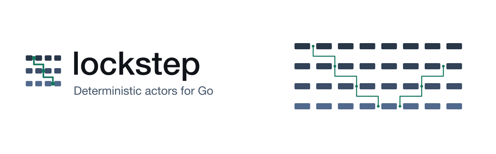

[](https://github.com/hmdsefi/lockstep/actions/workflows/build.yml?query=branch%3Amain)
[](https://pkg.go.dev/github.com/hmdsefi/lockstep)
[](https://github.com/hmdsefi/lockstep/releases/latest)
[](LICENSE)
[](https://github.com/hmdsefi/lockstep)

<p align="center">
  <picture>
    <source media="(prefers-color-scheme: dark)" srcset=".github/assets/readme-dark.svg">
    
  </picture>
</p>

<p align="center"><strong>Write actors. Get exact replay.</strong></p>

lockstep is an actor framework for Go with deterministic simulation testing (DST) built in. You
write typed actors with mailboxes, supervision, timers, and request and reply. The same actor code
runs in your program on `lockstep.New()`, and in `go test` on a seeded simulation that partitions
the network, drops and delays messages, and crashes and restarts nodes. Any failure in the
simulation replays exactly from its seed, so a bug that depends on timing becomes one command you
can rerun.

The actor model here is the one Erlang/OTP and Akka made familiar, and that Go libraries such as
protoactor-go, Hollywood, Ergo, and GoAkt also use. lockstep's runtime owns every message
delivery, timer, and I/O event, and that is what makes the simulation exact.

## Features

lockstep includes:

- **Typed actors and PIDs.** `Actor[M]` receives one message type and `PID[M]` accepts only that
  type, so a message of the wrong type does not compile.
- **Request and reply.** `Ask` with a typed `ReplyTo`, timeouts, and `Pipe`, which delivers the
  reply as a message instead of blocking the actor.
- **Bounded mailboxes** with an explicit policy when full: fail the send, drop the newest or
  oldest message, or block the sender.
- **Supervision trees** in the Erlang style: one-for-one and all-for-one strategies, restart
  limits with backoff, death watch, an actor cap, and a `Stopped` hook on every stop and restart.
- **Timers and effects** on the runtime's clock: `ctx.After`, `ctx.Every`, and I/O as named
  effects with `lockstep.Do`.
- **A pooled production engine.** `lockstep.New()` runs actors on a fixed pool of worker
  goroutines, so turns of different actors run in parallel while each actor handles one message at
  a time.
- **Overload protection** in the production engine: new actors and user messages are refused while
  the live heap is near its memory limit, a turn that runs too long is reported and its actor
  isolated, and a growing goroutine count is logged.
- **Logs and metrics.** The runtime logs failures, restarts, shutdown, and overload events to a
  `log/slog` logger, and every actor has a logger of its own. Counters and gauges go to a backend
  that you implement, for example for Prometheus, OpenTelemetry, or expvar.
- **Event-sourced persistent actors.** `persist.Spawn` starts an actor whose state is rebuilt from a
  journal of events. A reply sent from a `Then` callback goes out only after its events are fsynced,
  and a restart recovers from the newest snapshot and the events after it. `persist/filestore` is
  the reference journal and snapshot store. The same actor code runs on the operating system's files
  in production and on a simulated disk in tests, where crashes, torn writes, and failed syncs
  exercise the real recovery code.
- **Delivery helpers.** `lockstep/dedup` holds the state that handling duplicate and stale messages
  needs: a `Window` of idempotency keys and tombstones, a `Replies` cache of first replies, and a
  `Versions` gate per entity. Each value is bounded by age and count, and a persistent actor keeps
  it in its snapshots.
- **Remoting.** `remote.Enable` connects systems on different nodes over TCP, optionally with TLS.
  Sends, asks, replies, lookups and death watches work across nodes, in send order between one
  sender and one receiver. `lockstep/codec` encodes the messages: deterministic JSON by default, or
  protocol buffers from the nested module `codec/protobuf`.
- **Cluster membership.** `cluster.Join` runs a gossip membership protocol in the style of SWIM:
  probes, indirect probes, suspicion and refutation. A node reads the members from a `View` and
  subscribes actors to `NodeUp` and `NodeDown` signals.
- **Virtual actors.** A grain is an actor named by a kind and a key that exists whenever a message
  is sent to it. Rendezvous hashing picks its owner among the up members, the owner activates it
  on its first message and passivates it when it is idle, and ownership moves with membership.
- **Deterministic simulation testing** in `lockstep/sim`, built on
  [faultline](https://github.com/hmdsefi/faultline): multiple nodes, network partitions, message
  drops and delays, crashes and restarts, memory pressure, and exact replay from a seed.
- **Deadlock and leak detection** in simulation. A cycle of pending asks fails the seed with
  `lockstep: deadlock: A → B → A`. An actor that stops with an effect pending, a resource unclosed,
  or a file still open on the simulated disk fails it with a leak failure.
- **A static analyzer**, `lockstep-vet`, also available as a golangci-lint plugin. It reports
  `time.Now`, global randomness, goroutines, `select`, map ranges, and blocking calls in actor
  code, and it reports messages that share memory with their sender, actors that share state,
  ignored replies and errors, unhandled message types, and resources an actor never releases.
- **A Raft example** with three planted bugs that a seeded partition or crash exposes.

## Install

lockstep needs Go 1.26 or later:

```sh
go version
go get github.com/hmdsefi/lockstep@v0.3.0
```

## Quick start: a first actor

An actor is a type with a `Receive` method for one message type. The following program is a
counter: `Add` messages change its total, and a `Get` message asks for it.

```go
package main

import (
	"context"
	"fmt"
	"log"

	"github.com/hmdsefi/lockstep"
)

// Msg is every message the counter accepts.
type Msg interface{ isMsg() }

// Add adds N to the total.
type Add struct{ N int }

// Get asks for the total.
type Get struct{ Reply lockstep.ReplyTo[int] }

func (Add) isMsg() {}
func (Get) isMsg() {}

// Counter is an actor that keeps a running total.
type Counter struct{ total int }

func (c *Counter) Receive(ctx *lockstep.Context[Msg], msg Msg) {
	switch m := msg.(type) {
	case Add:
		c.total += m.N
	case Get:
		m.Reply.Send(ctx, c.total)
	}
}

func newCounter() lockstep.Actor[Msg] { return &Counter{} }

func getTotal(r lockstep.ReplyTo[int]) Msg { return Get{Reply: r} }

func main() {
	sys := lockstep.New()
	counter, err := lockstep.Spawn(sys, "counter", newCounter)
	if err != nil {
		log.Fatal(err)
	}
	for _, n := range []int{1, 2, 3} {
		if err := lockstep.Send[Msg](sys, counter, Add{N: n}); err != nil {
			log.Fatal(err)
		}
	}
	total, err := lockstep.Ask(sys, counter, getTotal).Await(context.Background())
	if err != nil {
		log.Fatal(err)
	}
	fmt.Println("total:", total)

	if err := sys.Shutdown(context.Background()); err != nil {
		log.Fatal(err)
	}
}
```

```sh
go run .
```

```text
total: 6
```

`Spawn` returns a `PID[Msg]`, so the compiler rejects a message of the wrong type. `Send` takes
`[Msg]` explicitly because `Add{N: n}` alone has type `Add`. `Ask` puts a `ReplyTo[int]` into the
`Get` message and returns a `*Reply[int]`. `Await` blocks, so call it outside actors; inside an
actor, `lockstep.Pipe` delivers the reply as a message instead.

## Configure the production engine

`lockstep.New()` runs actor turns on a fixed pool of worker goroutines. Turns of different actors
run in parallel, the turns of one actor never overlap, and messages from one sender to one
receiver arrive in send order. Timers and effect results run on the same workers. Four options
configure the engine:

- `WithWorkers(n)` sets the number of workers. The default is `runtime.GOMAXPROCS(0)`, read when
  `New` runs.
- `WithThroughput(n)` sets how many user messages an actor processes in one turn before it yields
  its worker to other actors. The default is 32.
- `WithActorThroughput(n)` is a `Spawn` option that replaces that limit for one actor, for example
  a small `n` for an actor whose messages are expensive.
- `WithEffectPool(workers, queue)` bounds effects started with `lockstep.Do`: at most `workers`
  run at once, and at most `queue` more wait for a free slot. The defaults are 64 and 1024. A `Do`
  call that finds both full resolves with `ErrOverloaded`.

The quick start's `main` can begin like this instead:

```go
sys := lockstep.New(
	lockstep.WithWorkers(4),
	lockstep.WithThroughput(64),
	lockstep.WithEffectPool(16, 256),
)
counter, err := lockstep.Spawn(sys, "counter", newCounter, lockstep.WithActorThroughput(256))
if err != nil {
	log.Fatal(err)
}
```

The options apply only to `lockstep.New()`. Simulation checks the values and then ignores them:
every turn there processes one message, in an order the seed decides.

## Protect the production engine from overload

`lockstep.New()` stops accepting new actors and user messages while the live heap is near its
limit, reports a turn that runs too long, and warns when the process has too many goroutines. Three
options tune this, and each has a default:

- `WithAdmission(high, low)` sets the memory thresholds in bytes.
- `WithWatchdog(d)` sets how long a turn may run before it counts as stuck.
- `WithGoroutineWarning(n)` sets the goroutine count that triggers a warning.

```go
sys := lockstep.New(
	lockstep.WithAdmission(768<<20, 640<<20),
	lockstep.WithWatchdog(2*time.Second),
	lockstep.WithGoroutineWarning(50_000),
)
```

### Memory admission

`New` samples the live heap before it returns and then every 100 ms. Without `WithAdmission`, the
thresholds follow the Go memory limit (`debug.SetMemoryLimit` or `GOMEMLIMIT`): admission stops
when the heap reaches 90% of the limit and resumes when it falls to 80%. With no memory limit set,
memory never refuses work. `WithAdmission(high, low)` replaces the limit with absolute byte
thresholds and needs `0 < low < high`. `WithAdmission(0, 0)` turns memory admission off, even when
a limit is set.

While admission is stopped:

- `Spawn` returns an error that matches `ErrOverloaded`. Restarts of existing actors are not
  refused.
- Each `Send` and `Ask` to a user actor is treated as if the target's mailbox were full, so the
  mailbox policy decides. Under `FailSend`, the error matches both `ErrOverloaded` and
  `ErrMailboxFull`. System messages, replies, timer messages, and effect results are not refused.
- Actors that called `ctx.SubscribeOverload` receive an `Overloaded` signal when admission stops
  and another when it resumes.

The system logs the change: `admission refusing` at Warn when it stops and `admission resumed` at
Info when it resumes.

### Stuck turns

A turn that never returns holds its worker, and the actor behind it stops answering. One watchdog
goroutine reports every turn that has run for at least the timeout. The default,
`DefaultWatchdogTimeout`, is 5 seconds, and `WithWatchdog(0)` turns the watchdog off.

The report is one log line at Error with the actor's path and the stack of the worker goroutine
that runs the turn. From then until the turn returns, the actor counts as stuck. User messages to
it get its mailbox policy as if the mailbox were full, and under `FailSend` the error matches
`ErrMailboxFull`. System messages, such as `Stop`, still queue, and a `Stop` that queued while the
turn was stuck stops the actor after the turn returns, without a restart. Otherwise, when the turn
returns, the incarnation fails with an error that matches `ErrTimeout`, and its supervisor decides
whether to restart, stop, or escalate.

lockstep cannot preempt a turn. A turn that never returns keeps its worker, and `Shutdown` with a
deadline returns the context's error when the deadline passes.

### Goroutine count

Once a second, the system counts the goroutines of the whole process, not only lockstep's. When the
count reaches the bound from `WithGoroutineWarning(n)`, the system logs one warning at Warn with
the count and a summary of the ten functions that hold the most goroutines. The default,
`DefaultGoroutineWarning`, is 10,000, and `WithGoroutineWarning(0)` turns the warning off. After a
warning, the next one waits until the count falls below 80% of the bound and reaches it again.

### Logs and invalid values

These events go to the system logger, each with a `node` attribute. Without `WithLogger`, the
system logger is the one `slog.Default()` returned when `New` ran, so set the default logger before
you call `New`. [Logs and metrics](#logs-and-metrics) describes `WithLogger`. A negative watchdog
timeout or goroutine bound, or a non-zero `WithAdmission` pair other than `0 < low < high`, makes
`New` panic with an error that wraps `ErrInvalidOption`.

Simulation checks these values and then ignores them. It stays deterministic, and overload there
comes from `sim.Options.Budget` and `s.Pressure`, described in
[Architecture](docs/architecture.md#overload). The actor cap, `WithMaxActors`, applies in both
engines.

## Logs and metrics

`lockstep.New()` writes the runtime's events to a `log/slog` logger, gives every actor a logger of
its own, and reports counters and gauges to a metrics backend that you provide. Neither adds a
dependency to your module.

`WithLogger` sets the system logger. Without it, the system logger is `slog.Default()` as it is
when `New` runs, so a later `slog.SetDefault` does not change a running system. To discard the
logs, pass `slog.New(slog.DiscardHandler)`.

Inside an actor, `ctx.Logger()` returns the system logger with the actor's `node`, `path`, and `uid`
attributes. `ctx.Logf` logs a formatted line at Info through it, and the record's source is the line
that called `Logf`. The quick start's counter can log each addition, with `log/slog` and `os` added
to its imports:

```go
// In main:
logger := slog.New(slog.NewJSONHandler(os.Stderr, nil))
sys := lockstep.New(lockstep.WithNodeName("counter-1"), lockstep.WithLogger(logger))

// In Counter.Receive, after c.total += m.N:
ctx.Logger().Info("added", "n", m.N, "total", c.total)
```

Each record carries `node`, `path`, and `uid` before `n` and `total`.

The runtime logs its own events through the same logger: failures and restarts, shutdown, and the
overload events above. The Debug events are a full mailbox, a shed message, a dropped message, and a
dead letter.

`WithMetrics` takes a value that implements `lockstep.Metrics`. lockstep ships no adapter, so you
write one for the backend you use, such as Prometheus, OpenTelemetry, or expvar. Its `Counter`
method registers a counter series and returns a `lockstep.Counter`, and its `GaugeFunc` method
registers a gauge function. Both take the series' labels as `lockstep.MetricLabel` values.
[Metrics](docs/architecture.md#metrics) in the architecture page shows the whole interface.

`New` registers every series with the backend before it returns, and each series carries a `node`
label first. lockstep adds to the counters as events happen, and the backend calls the gauge
functions when it collects. Without `WithMetrics`, nothing is registered or counted.

In simulation, `ctx.Logger()` and `ctx.Logf` write to the node's kernel log. faultline gives each
simulated node a kernel log, and its records go into `trace.jsonl` and the trace hash. The same seed
therefore gives the same lines. Metrics are off there, and `WithLogger` and `WithMetrics` in
`sim.Options.System` have no effect.

[Architecture](docs/architecture.md#logs-and-metrics) lists every event with its level and
attributes, every counter and gauge, and an example adapter.

## Deterministic simulation testing: the same actor under faults

`sim.Simulate` runs a test body once per seed. Each run is a simulated world with virtual time
and a simulated network. The following test runs the counter on server node `n1`, sends 20 `Add`
messages from client node `c1`, and lets faultline crash and restart `n1` at random times. A
final check runs when the run ends:

```go
package main

import (
	"errors"
	"fmt"
	"testing"
	"time"

	"github.com/hmdsefi/faultline"
	"github.com/hmdsefi/faultline/kernel/fault"
	"github.com/hmdsefi/lockstep"
	"github.com/hmdsefi/lockstep/codec"
	"github.com/hmdsefi/lockstep/remote"
	"github.com/hmdsefi/lockstep/sim"
)

// Add and Get cross nodes in the test, so they have wire names.
func init() {
	codec.Register[Add]("counter.Add")
	codec.Register[Get]("counter.Get")
}

func TestCounter(t *testing.T) {
	opts := sim.Options{Options: faultline.Options{Seeds: 50, Duration: 10 * time.Second}}
	sim.Simulate(t, opts, func(s *sim.Sim) {
		w := s.World()
		var counter lockstep.PID[Msg]
		s.Node("n1", func(sys *lockstep.System) {
			counter, _ = lockstep.Spawn(sys, "counter", newCounter)
		})
		s.Client("c1", func(*lockstep.System) {})
		w.Plan(&fault.Random{MaxDown: 1, Rules: []fault.Rule{
			{Kind: fault.KindCrash, Every: 8 * time.Second, MaxFor: time.Second},
		}})

		for range 20 {
			w.RunFor(250 * time.Millisecond)
			if err := sim.Send[Msg](s, "c1", counter, Add{N: 1}); err != nil {
				w.T().Fatal(err)
			}
		}
		w.RunFor(4 * time.Second) // faults stop at 7.5s, a quarter before the end
		total, err := sim.Ask(s, "c1", counter, getTotal)
		if errors.Is(err, remote.ErrPeerRestarted) { // the first ask after a restart can fail
			total, err = sim.Ask(s, "c1", counter, getTotal)
		}
		w.Final("every add counted", func() error {
			if err != nil {
				return err
			}
			if total != 20 {
				return fmt.Errorf("total is %d after 20 adds", total)
			}
			return nil
		})
	})
}
```

Nodes in a simulation talk as production nodes do, so a message to another node is encoded:
`init` registers `Add` and `Get` under wire names, and the answer, an `int`, needs no
registration. [Send messages across nodes](#send-messages-across-nodes) explains this. When a node
restarts, an ask that `c1` sent before it learned of the restart fails with an error that matches
`remote.ErrPeerRestarted`, so the test asks once more.

The test imports faultline directly, so add it to `go.mod` and run the test:

```sh
go mod tidy
go test .
```

```text
--- FAIL: TestCounter (0.01s)
    counter_test.go:25: faultline: running 50 seeds from base 0x64b5629963419063 (test name)
    --- FAIL: TestCounter/seed=0x870af07a512d3866 (0.01s)
        faultline: final check "every add counted" failed after the run at t=10.000000000s
          total is 0 after 20 adds
        replay:    FAULTLINE_SEED=0x870af07a512d3866 go test -v -run '^TestCounter$' example.com/counter
        artifacts: $TMPDIR/faultline-501/example.com_counter/TestCounter/870af07a512d3866/
    counter_test.go:25: faultline: stopping after failing seed 0x870af07a512d3866; 48 of 50 seeds not run (set Options.KeepGoing to run all)
FAIL
FAIL	example.com/counter	0.330s
FAIL
```

The first seed passes and the second fails. The counter keeps its total in memory, so a crash
loses it. The run's `schedule.json` artifact shows when: `n1` crashed at t=4.87s, after 19 adds,
and restarted at t=5.71s with a new counter. The 20th add reached a node that was down.

The seeds come from the test's name, so they are the same on every machine. The `replay` line is
the command that runs the failing seed again:

```sh
FAULTLINE_SEED=0x870af07a512d3866 go test -v -run '^TestCounter$' example.com/counter
```

```text
=== RUN   TestCounter
    counter_test.go:25: faultline: FAULTLINE_SEED=0x870af07a512d3866: running 1 seed
=== RUN   TestCounter/seed=0x870af07a512d3866
    faultline: final check "every add counted" failed after the run at t=10.000000000s
      total is 0 after 20 adds
    replay:    FAULTLINE_SEED=0x870af07a512d3866 go test -v -run '^TestCounter$' example.com/counter
    artifacts: $TMPDIR/faultline-501/example.com_counter/TestCounter/870af07a512d3866/
--- FAIL: TestCounter (0.01s)
    --- FAIL: TestCounter/seed=0x870af07a512d3866 (0.01s)
FAIL
FAIL	example.com/counter	0.250s
FAIL
```

The replay fails the same check at the same virtual time, and its `report.json` holds the same
trace hash (a hash of every event in the run) as the first run: `0x619b75850de90f63`. faultline
writes the artifacts under `os.TempDir()`, shown here as `$TMPDIR`; they include `trace.jsonl`,
`timeline.txt`, and a self-contained `timeline.html`.

Besides the checks you register, `sim` fails a seed when actors deadlock on each other's asks
(`lockstep: deadlock: A → B → A`), when an effect has no handler, and when an actor stops or
restarts with an effect still pending, a resource it owns failing to close, or a file it opened on
the simulated disk still open.

## Persistent actors: state that survives a restart

An event-sourced actor stores the events that produced its state. `persist.Spawn` starts one under
a persistence ID, the name of its stream of events. A command handler returns events. lockstep
writes them to a journal, calls fsync, and only then applies them to the state and runs the
callbacks you registered with `ctx.Then`, so a reply sent from a callback tells the caller that the
events are on disk. When the actor starts or restarts, it recovers its state from the newest
snapshot and the events after it.

The following program is a bank account. A `Deposit` stores a `Deposited` event and replies with
the new balance:

```go
package main

import (
	"context"
	"fmt"
	"log"

	"github.com/hmdsefi/lockstep"
	"github.com/hmdsefi/lockstep/persist"
	"github.com/hmdsefi/lockstep/persist/filestore"
)

// Deposit adds Amount to the account and replies with the new balance.
type Deposit struct {
	Amount int64
	Reply  lockstep.ReplyTo[int64]
}

// Deposited is the event that a Deposit stores.
type Deposited struct{ Amount int64 }

// Account is an event-sourced actor whose state is its balance.
type Account struct{}

func (Account) Initial() int64 { return 0 }

func (Account) Handle(ctx *persist.Context[Deposit, Deposited, int64], _ int64, d Deposit) []Deposited {
	ctx.Then(func(ctx *persist.Context[Deposit, Deposited, int64], balance int64) {
		d.Reply.Send(ctx, balance) // runs after the event is committed
	})
	return []Deposited{{Amount: d.Amount}}
}

func (Account) Apply(balance int64, e Deposited) int64 { return balance + e.Amount }

func newAccount() persist.EventSourced[Deposit, Deposited, int64] { return Account{} }

func deposit(amount int64) func(lockstep.ReplyTo[int64]) Deposit {
	return func(r lockstep.ReplyTo[int64]) Deposit { return Deposit{Amount: amount, Reply: r} }
}

func main() {
	store, err := filestore.Open("data")
	if err != nil {
		log.Fatal(err)
	}
	sys := lockstep.New()
	account, err := persist.Spawn(sys, "account", "acct-1", newAccount, persist.Config[Deposited, int64]{
		Journal: store,
		Events:  persist.JSON[Deposited](),
	})
	if err != nil {
		log.Fatal(err)
	}
	balance, err := lockstep.Ask(sys, account, deposit(5)).Await(context.Background())
	if err != nil {
		log.Fatal(err)
	}
	fmt.Println("balance:", balance)

	if err := sys.Shutdown(context.Background()); err != nil {
		log.Fatal(err)
	}
}
```

Run it twice:

```sh
go run .
go run .
```

```text
balance: 5
balance: 10
```

The first run creates the directory `data`. The second run starts a new system on the same
directory and recovers the balance of 5 from the journal before it handles the new deposit.

`Initial` returns the state before the first event, `Handle` turns a command into events, and
`Apply` folds one event into the state. `Apply` must be a pure function of its arguments, because
recovery calls it again for every stored event. An actor handles one command at a time, and while
it recovers and while a batch of events is being committed, its commands wait in the mailbox. The
actor's message type is the command type, so `Send` and `Ask` reach it like any actor.
`persist.JSON` encodes events with `encoding/json`. Any `persist.Codec` works whose `Encode` is
deterministic and returns a slice it does not reuse afterwards.

To start recovery from a snapshot instead of from the first event, give the `Config` a snapshot
store and a codec for the state. A `*filestore.Store` is both the journal and the snapshot store:

```go
persist.Config[Deposited, int64]{
	Journal:       store,
	Events:        persist.JSON[Deposited](),
	Snapshots:     store,
	State:         persist.JSON[int64](),
	SnapshotEvery: 100,
	PruneEvents:   true,
}
```

The actor saves a snapshot after every 100 committed events, beside its commands. With
`PruneEvents`, it deletes the events that an older snapshot covers. The newest two snapshots and the
events after the older one stay, so a damaged newest snapshot falls back to the older one.

A failed write or commit fails the actor, with an error that wraps the store's error, and its
supervisor decides what happens next. No reply goes out for events that did not commit, and a
restart recovers the state from what the store holds.

### The same actor on a simulated disk

`filestore.Open` uses the operating system's files. In a simulation, `s.Volume("n1")` returns the
simulated disk of node `n1` as a `filestore.FS`, and `filestore.New` runs a store on it. The disk
is faultline's: it keeps what was synced when the node crashes, and `Options.Disk` chooses what a
crash does to writes that were not synced (lose them, keep some, or tear one) and what a failed
sync does to pending writes, sets the capacity, and adds latency. A planner makes syncs fail. The
following test crashes and restarts `n1` while `c1` deposits 1, 20 times, and checks that no
acknowledged deposit is lost. It adds to the program above, and like the first test it imports
faultline directly:

```go
package main

import (
	"errors"
	"fmt"
	"testing"
	"time"

	"github.com/hmdsefi/faultline"
	"github.com/hmdsefi/faultline/kernel/fault"
	"github.com/hmdsefi/faultline/kernel/simdisk"
	"github.com/hmdsefi/lockstep"
	"github.com/hmdsefi/lockstep/codec"
	"github.com/hmdsefi/lockstep/persist"
	"github.com/hmdsefi/lockstep/persist/filestore"
	"github.com/hmdsefi/lockstep/remote"
	"github.com/hmdsefi/lockstep/sim"
)

// Deposit crosses nodes in the test, so it has a wire name.
func init() { codec.Register[Deposit]("account.Deposit") }

func TestAccount(t *testing.T) {
	opts := sim.Options{Options: faultline.Options{Seeds: 50, Duration: 20 * time.Second}}
	opts.Disk.Latency = simdisk.DefaultLatency()
	sim.Simulate(t, opts, func(s *sim.Sim) {
		w := s.World()
		var account lockstep.PID[Deposit]
		s.Node("n1", func(sys *lockstep.System) {
			store := filestore.New(s.Volume("n1"))
			account, _ = persist.Spawn(sys, "account", "acct-1", newAccount, persist.Config[Deposited, int64]{
				Journal: store,
				Events:  persist.JSON[Deposited](),
			})
		})
		s.Client("c1", func(*lockstep.System) {})
		w.Plan(&fault.Random{MaxDown: 1, Rules: []fault.Rule{
			{Kind: fault.KindCrash, Every: 4 * time.Second, MaxFor: time.Second},
		}})

		var acked int64
		for range 20 {
			w.RunFor(250 * time.Millisecond)
			if _, err := sim.Ask(s, "c1", account, deposit(1), lockstep.WithTimeout(500*time.Millisecond)); err == nil {
				acked++
			}
		}
		w.RunFor(10 * time.Second) // faults stop at 15s, a quarter before the end
		balance, err := sim.Ask(s, "c1", account, deposit(0))
		if errors.Is(err, remote.ErrPeerRestarted) { // the first ask after a restart can fail
			balance, err = sim.Ask(s, "c1", account, deposit(0))
		}
		w.Final("no acknowledged deposit is lost", func() error {
			if err != nil {
				return err
			}
			if balance < acked {
				return fmt.Errorf("balance %d after %d acknowledged deposits", balance, acked)
			}
			return nil
		})
	})
}
```

The recovery that runs after every crash is the code that runs in production, on a disk that lost
or tore the writes that were not synced. A store that acknowledged a deposit before its fsync could
lose it in a crash, and the check would fail on the seed that finds it.

A `Volume` belongs to its node. Using it from another node, or from outside a node event, fails the
seed with `lockstep/misuse`, and a file that an actor leaves open when it stops or restarts fails
it with `lockstep/leak`. A `Store` closes every file before a call returns, so only code that opens
files itself can leak one. [Architecture](docs/architecture.md#persistence) describes the journal
format, the fsync order, and how recovery tells a torn write from corruption.

## Send messages across nodes

A PID names its node, so the same `Send`, `Ask` and `Watch` reach an actor on another node. Package
`remote` carries those messages between systems over TCP, and package `codec` turns each message
into bytes and back. The following program runs two nodes, `a` and `b`, in one process and asks a
greeter on `b` from `a`. In production each node is its own process, and the code of each is the
same:

```go
package main

import (
	"context"
	"fmt"
	"log"

	"github.com/hmdsefi/lockstep"
	"github.com/hmdsefi/lockstep/codec"
	"github.com/hmdsefi/lockstep/remote"
)

// Greet asks for a greeting for Name.
type Greet struct {
	Name  string
	Reply lockstep.ReplyTo[string]
}

// Greet crosses nodes, so it has a wire name, the same on every node.
func init() { codec.Register[Greet]("example.Greet") }

// Greeter answers every Greet with the name of the node it runs on.
type Greeter struct{}

func (Greeter) Receive(ctx *lockstep.Context[Greet], g Greet) {
	g.Reply.Send(ctx, "hello "+g.Name+" from "+ctx.Self().Address().Node())
}

func newGreeter() lockstep.Actor[Greet] { return Greeter{} }

func greet(name string) func(lockstep.ReplyTo[string]) Greet {
	return func(r lockstep.ReplyTo[string]) Greet { return Greet{Name: name, Reply: r} }
}

func main() {
	ctx := context.Background()

	// Node b runs the greeter and listens on 127.0.0.1:7102.
	b := lockstep.New(lockstep.WithNodeName("b"))
	if err := remote.Enable(b, remote.Config{Listen: "127.0.0.1:7102"}); err != nil {
		log.Fatal(err)
	}
	if _, err := lockstep.Spawn(b, "greeter", newGreeter); err != nil {
		log.Fatal(err)
	}

	// Node a knows b's address and dials it on the first message.
	a := lockstep.New(lockstep.WithNodeName("a"))
	if err := remote.Enable(a, remote.Config{
		Listen: "127.0.0.1:7101",
		Peers:  map[string]string{"b": "127.0.0.1:7102"},
	}); err != nil {
		log.Fatal(err)
	}

	greeter, err := remote.Lookup[Greet](ctx, a, "b", "/user/greeter")
	if err != nil {
		log.Fatal(err)
	}
	answer, err := lockstep.Ask(a, greeter, greet("a")).Await(ctx)
	if err != nil {
		log.Fatal(err)
	}
	fmt.Println(answer)

	for _, sys := range []*lockstep.System{a, b} {
		if err := sys.Shutdown(ctx); err != nil {
			log.Fatal(err)
		}
	}
}
```

```text
hello a from b
```

`remote.Enable` switches remoting on for a system that `lockstep.New` built. The system listens on
`Listen` and dials a peer when it first sends to it: at the address `Peers` names, else the one
`Resolve` returns, else the address the peer announced when it connected. Here `b` has no address
for `a`, because `a` announced its own when it dialed. `remote.Lookup` asks `b` for the actor at a
path and returns its PID. `lockstep.PIDAt[Greet]("b", "/user/greeter")` names the same actor
without a round trip: a message to it reaches whichever actor is registered at the path when the
message arrives.

Messages from one sender to one receiver arrive in send order and at most once, across nodes as on
one node. A message can be lost when its connection breaks, and lockstep does not retry it. A
failure that the other node reports, such as a `remote.Lookup` of a path where no actor is
registered, comes back as a `*remote.Error`, and `errors.Is` matches it with the lockstep error its
code stands for, here `lockstep.ErrNotFound`. When a peer's process restarts, the asks that wait
on the old process fail with an error that matches `remote.ErrPeerRestarted`, and death watches of
its actors end. `Shutdown` closes the connections once the last actor has stopped. `Config.TLS`
makes both the listener and the dialer use TLS.

### Wire names and codecs

A message to another node travels as a wire name and the bytes of its value. The wire name tells
the receiving node which Go type to decode, so every type that crosses nodes is registered under
one name, the same on every node, before the first message of that type is sent. The program above
does this in `init`. A name is 1 to 255 bytes: an ASCII letter, then letters, digits, `.`, `_`,
`/` and `-`. Names that start with `lockstep.` are reserved, except those that start with
`lockstep.cluster.`, which package `cluster` uses. Registering one name for two types, or one type
under two names, panics. A message whose type is not registered makes `Send` return an error, and
nothing is sent.

Plain values need no registration. `bool`, `int` and `uint` and their sized forms, `float32`,
`float64`, `string`, `[]byte`, `struct{}`, `time.Duration`, `time.Time` and `lockstep.Address` are
built in, so the `string` answer above crosses without one. A `PID` or a `ReplyTo` travels as a
field of a registered message.

The default codec, `codec.JSON`, encodes with `encoding/json`, and equal values give equal bytes.
Its check rejects a type that `encoding/json` would encode lossily or not at all, such as a struct
with an interface field or an unexported field. `remote.Enable` runs the check over every
registered type, so such a type fails when the system starts rather than at its first message.
Every node uses the same codec, and two nodes with different codecs refuse to connect.

For messages that are already protocol buffers, the nested module `codec/protobuf` has a codec for
generated message types. It is a module of its own, so that lockstep itself never requires
`google.golang.org/protobuf`:

```sh
go get github.com/hmdsefi/lockstep/codec/protobuf@v0.3.0
```

Register each generated message type as its pointer type, `*M`, and set `Codec: protobuf.Codec{}`
in the `remote.Config` of every node. A node that joins a cluster keeps `codec.JSON` for remoting,
because the cluster's own messages are plain structs, and sets the protobuf codec for its grains in
`cluster.Config.Codec` instead. [Distribution](docs/distribution.md) describes both codecs, the
connections between nodes, and the errors in more detail.

## Cluster membership

`cluster.Join` makes a system a member of a cluster, a group of nodes that track which of them are
up. It starts the system actor `/system/cluster`, which joins through the seed nodes and keeps the
member table, and returns a `*cluster.Membership`. The members talk through remoting, so a
production system enables it before it joins. Node `n1` joins a cluster of three nodes, `n1`, `n2`
and `n3`, and subscribes an actor to the members that come up and go down. `n2` and `n3` run the
same code with their own names and addresses:

```go
// Watcher logs every member that comes up or goes down.
type Watcher struct{}

func (Watcher) Receive(*lockstep.Context[struct{}], struct{}) {}

func (Watcher) Signal(ctx *lockstep.Context[struct{}], sig lockstep.Signal) {
	switch s := sig.(type) {
	case lockstep.NodeUp:
		ctx.Logf("%s is up", s.Node)
	case lockstep.NodeDown:
		ctx.Logf("%s is down (left: %t)", s.Node, s.Left)
	}
}

func newWatcher() lockstep.Actor[struct{}] { return Watcher{} }
```

```go
// In main:
sys := lockstep.New(lockstep.WithNodeName("n1"))
if err := remote.Enable(sys, remote.Config{
	Listen: "10.0.0.1:7000",
	Peers:  map[string]string{"n2": "10.0.0.2:7000", "n3": "10.0.0.3:7000"},
}); err != nil {
	log.Fatal(err)
}
m, err := cluster.Join(sys, cluster.Config{Seeds: []string{"n1", "n2", "n3"}})
if err != nil {
	log.Fatal(err)
}
watcher, err := lockstep.Spawn(sys, "watcher", newWatcher)
if err != nil {
	log.Fatal(err)
}
if err := m.Subscribe(watcher.Address()); err != nil {
	log.Fatal(err)
}
```

Every second, each node probes one other member. A member that does not answer in time is probed
again through up to three other members, and a member that still has not answered at the next
probe becomes `Suspect`. A suspected member that does not refute the suspicion within 5 seconds
becomes `Dead`. News about members travels on the probes, and nodes exchange their whole member
tables now and then, so the two sides of a healed partition learn of each other.
`cluster.Config` sets each of these intervals.

`m.View()` returns the latest view, an immutable snapshot of the member table, without sending a
message. A member is `Alive`, `Suspect`, `Dead` or `Left`. `Alive` and `Suspect` members are up,
and `View.Up` lists them. A member's `ID` is the incarnation of its process, so a node that
restarts comes back as a new member under its old name.

A subscriber receives a `lockstep.NodeUp` for every other member that is up when it subscribes,
then `NodeUp` and `NodeDown` signals in the order of the views. A death watch of an actor on a node
that goes down ends with a failure that wraps `cluster.ErrNodeDown`. `m.Leave()` and `Shutdown`
leave the cluster: the other members see the node as `Left`, not `Dead`, and their subscribers get
a `NodeDown` with `Left` set.

## Virtual actors: grains

A grain is an actor named by a kind and a key, such as `counter` and `user-42`, that exists
whenever a message is sent to it: no code spawns or stops it. A node lists the kinds it hosts in
`cluster.Config.Kinds`, each made by `cluster.NewKind` with the factory of its activations, the
actors that run the grains. `Join` starts a host for each kind. The following program hosts the
kind `counter` on a cluster of one node, sends the grain `user-42` three `Add` messages, and asks
for its total:

```go
package main

import (
	"context"
	"fmt"
	"log"
	"time"

	"github.com/hmdsefi/lockstep"
	"github.com/hmdsefi/lockstep/cluster"
	"github.com/hmdsefi/lockstep/codec"
)

// CounterMsg is every message a counter grain accepts.
type CounterMsg interface{ isCounterMsg() }

// Add adds N to the grain's total.
type Add struct{ N int }

// Get asks for the grain's total.
type Get struct{ Reply lockstep.ReplyTo[int] }

func (Add) isCounterMsg() {}
func (Get) isCounterMsg() {}

// Messages for a grain on another node cross nodes, so they have wire names.
func init() {
	codec.Register[Add]("example.Add")
	codec.Register[Get]("example.Get")
}

// Counter is the activation of one counter grain: the actor that runs it on its owner.
type Counter struct{ total int }

func (c *Counter) Receive(ctx *lockstep.Context[CounterMsg], msg CounterMsg) {
	switch m := msg.(type) {
	case Add:
		c.total += m.N
	case Get:
		m.Reply.Send(ctx, c.total)
	}
}

// counterKind returns the kind of the counter grains. Its factory gets the grain's key.
func counterKind() cluster.Kind {
	return cluster.NewKind("counter", func(key string) lockstep.Actor[CounterMsg] {
		return &Counter{}
	}, cluster.WithIdleTimeout(time.Minute))
}

func getTotal(r lockstep.ReplyTo[int]) CounterMsg { return Get{Reply: r} }

func main() {
	sys := lockstep.New(lockstep.WithNodeName("n1"))
	m, err := cluster.Join(sys, cluster.Config{Kinds: []cluster.Kind{counterKind()}})
	if err != nil {
		log.Fatal(err)
	}
	// Grain messages are refused until the node has joined, which takes one turn.
	for h, _ := m.Host("counter"); !h.Joined; h, _ = m.Host("counter") {
		time.Sleep(time.Millisecond)
	}

	counter := cluster.GrainOf[CounterMsg](m, "counter", "user-42")
	for _, n := range []int{1, 2, 3} {
		if err := counter.Send(sys, Add{N: n}); err != nil {
			log.Fatal(err)
		}
	}
	total, err := cluster.Ask(sys, counter, getTotal).Await(context.Background())
	if err != nil {
		log.Fatal(err)
	}
	h, _ := m.Host("counter")
	fmt.Println("total:", total, "active:", h.Active)

	if err := sys.Shutdown(context.Background()); err != nil {
		log.Fatal(err)
	}
}
```

```text
total: 6 active: [user-42]
```

`cluster.GrainOf` returns a `Grain[M]`, a small value that holds no state of the grain, so any code
can build one. `Grain.Send` and `cluster.Ask` route a message to the grain's owner: among the up
members that host the kind, the one with the highest rendezvous hash of the kind, the key and its
node name, so every node computes the same owner from the same view. The owner's host activates
the grain on its first message, by calling the factory with the key, and delivers every message for
the key to that activation. `Membership.Host` describes the host of a kind on this node: its active
keys, the keys it is stopping or waiting for, and the number of messages it holds.

`Send` returns an error when the message cannot be routed: before the node has joined
(`cluster.ErrNotJoined`, which is why the program waits for the host to see a joined view), when no
up member hosts the kind (`ErrNoOwner`), for a key that is not 1 to 256 bytes long
(`ErrInvalidKey`), after `Leave` (`ErrLeft`), and when this node hosts the kind with another
message type. It also returns the encoding error when another node owns the grain and the message
cannot be encoded, and the error of the send itself, wrapped, such as `lockstep.ErrMailboxFull`
from this node's host. A message that a host later cannot hold, deliver or forward is dropped and
traced, and `Send` does not report it; an ask then resolves at its timeout. A node with no kinds
in its `Config` hosts no grains but sends to them.

A message for a grain that another node owns is encoded with `Config.Registry` and `Config.Codec`,
so its type is registered on every node that sends to or hosts the kind. While the owner does not
change and nothing is dropped, messages from one sender reach the activation in send order. An
activation that gets no message for the kind's idle timeout, 10 minutes unless `WithIdleTimeout`
sets it, is stopped, and the next message activates the grain again with a new actor from the
factory.

When the members change, so do the owners of some keys. A node that becomes the owner of a key that
other nodes may still run first asks those nodes to stop their activations, and holds the key's
messages meanwhile. It activates the key when every such node has answered, or when the kind's
handoff timeout has passed. While the views of two nodes disagree about an owner, a host forwards
a message to the owner it sees, at most `Config.MaxHops` times. Once the views of the nodes agree
and every host has applied its node's view, no key is in the active set of two nodes. An activation
that the change passivated may still be stopping, and after a handoff timeout it can run beside the
new one. While the views disagree, for example during a partition, two nodes can each run an
activation of the same key. [Distribution](docs/distribution.md#virtual-actors) describes
placement, handoff, and the limits of this guarantee.

### The same cluster in simulation

In `lockstep/sim`, every node runs remoting. Its frames travel as datagrams on faultline's simulated
network, where partitions and lossy links apply to them, and every message between nodes is
encoded as in production. `sim.Options.Remote` holds the protocol settings, the codec and the
registry of every node. Its network fields, such as `Listen`, are ignored, and a node's setup may
call `remote.Enable` as production code does. `cluster.Join` runs unchanged: its probes, its timers
and its random choices come from the seed, so a run of a cluster replays exactly too.

The following test runs three nodes that host the counter grains and a client node `c1` that hosts
none. `c1` sends one grain 20 `Add` messages while faultline crashes nodes and cuts the network,
and a final check asks the grain for its total after the faults have stopped. It adds to the
program above:

```go
package main

import (
	"context"
	"fmt"
	"testing"
	"time"

	"github.com/hmdsefi/faultline"
	"github.com/hmdsefi/faultline/kernel/fault"
	"github.com/hmdsefi/lockstep"
	"github.com/hmdsefi/lockstep/cluster"
	"github.com/hmdsefi/lockstep/sim"
)

func TestCounterGrain(t *testing.T) {
	opts := sim.Options{Options: faultline.Options{Seeds: 20, Duration: 50 * time.Second}}
	sim.Simulate(t, opts, func(s *sim.Sim) {
		w := s.World()
		nodes := []string{"n1", "n2", "n3"}
		for _, name := range nodes {
			s.Node(name, func(sys *lockstep.System) {
				if _, err := cluster.Join(sys, cluster.Config{Seeds: nodes, Kinds: []cluster.Kind{counterKind()}}); err != nil {
					panic(err)
				}
			})
		}
		var m *cluster.Membership
		s.Client("c1", func(sys *lockstep.System) {
			var err error
			if m, err = cluster.Join(sys, cluster.Config{Seeds: nodes}); err != nil { // hosts no kind
				panic(err)
			}
		})
		w.Plan(&fault.Random{MaxDown: 1, Quiet: 25 * time.Second, Rules: []fault.Rule{
			{Kind: fault.KindCrash, Every: 10 * time.Second, MaxFor: 3 * time.Second},
			{Kind: fault.KindPartition, Every: 10 * time.Second, MaxFor: 3 * time.Second},
		}}) // faults stop at 25s, when the Adds end

		w.RunFor(5 * time.Second)
		counter := cluster.GrainOf[CounterMsg](m, "counter", "user-42")
		for range 20 {
			w.RunFor(time.Second)
			_ = counter.Send(s.System("c1"), Add{N: 1}) // the Add may be lost
		}
		w.RunFor(w.RecoveryStart().Sub(w.Sim.Now()) + 10*time.Second) // time to recover
		reply := cluster.Ask(s.System("c1"), counter, getTotal)
		w.RunFor(6 * time.Second) // longer than the ask's timeout, so the reply has resolved
		total, err := reply.Await(context.Background())
		w.Final("the grain answers, and no Add counts twice", func() error {
			if err != nil {
				return err
			}
			if total > 20 {
				return fmt.Errorf("total is %d after 20 adds", total)
			}
			return nil
		})
	})
}
```

The test passes, but on many seeds the total is less than 20. The grain keeps its total in memory,
so a crash of its owner loses it, and an `Add` sent into a cut or to a node that is down is lost:
grains get lockstep's delivery, at most once, and nothing more. A check for `total == 20` fails on
one of the first seeds, and its seed replays like the counter's above.

`Reply.Await` never waits in a simulation, so the test runs the world past the ask's timeout before
it reads the reply. For the same reason, `remote.Lookup` of another node from a test body fails the
seed; address the actor with `lockstep.PIDAt` instead.

## Static analysis: lockstep-vet and golangci-lint

A replay is exact only if actor code takes time, randomness, and I/O from the runtime, and actors
share nothing but messages. `lockstep-vet` runs nine analyzers, which report ten check codes:

- `LS100`: nondeterminism and blocking in actor code, such as `time.Now`, global `math/rand`,
  `crypto/rand`, a `go` statement, `select`, a range over a map, environment variables, channel
  operations, locks, and blocking network, file, database, or process calls.
- `LS110`: `Reply.Await` in actor code, which blocks the actor; use `lockstep.Pipe` instead.
- `LS200`: a variable used after it was sent. Once `lockstep.Send`, `lockstep.Ask`, or
  `ReplyTo.Send` returns, the receiver owns the slice, map, or pointer in the message, so the
  sender must copy it before sending or stop using it. `lockstep-vet` reports a use that the
  function's control flow can reach after the send, and only a use of the part that was sent:
  sending `s.items` and then reading `s.count` is fine. Assigning the variable again ends the
  tracking, unless the message holds the variable's own storage, such as its address or a slice of
  an array variable, where the assignment overwrites what was sent and is reported. On the branch
  where `lockstep.Send` returned an error, nothing was delivered, so the sender may keep using
  the message, for example to retry. A message type marked `//lockstep:immutable` is safe to send
  and keep.
- `LS201`: a type marked `//lockstep:immutable` that isn't. A field may hold basic values,
  `error`, `time.Time`, `lockstep.PID`, `lockstep.Address`, `lockstep.ReplyTo`, other immutable
  types and pointers to them, and arrays, slices, maps, and structs of those. Any other pointer,
  a channel, a function, an interface, a type parameter, and `unsafe.Pointer` are reported. No
  code may write into a slice or map field of the type or assign through a pointer to it, except
  to build a new value: writes to a local variable that the function initializes from `T{...}`,
  `&T{...}`, or `new(T)` and assigns nothing else are construction.
- `LS210`: shared mutable state. Actor code that writes a package variable is reported, and so is
  actor code that places the actor itself, a field that holds references, the address of a field,
  or a `*lockstep.Context` in a message. A field whose type is marked `//lockstep:immutable` may
  go in a message.
- `LS220`: the reply of `lockstep.Ask` that is never awaited or piped, and the error of
  `lockstep.Send` or `lockstep.Spawn` that is ignored.
- `LS230`: a message type with no case in `Receive`. When the actor's message type is an interface
  with an unexported method, every type of its package that implements it needs a case. So does
  every type the actor sends to itself through `ctx.After`, `ctx.Every`, `lockstep.Do`, or
  `lockstep.Pipe`. A case is a type in a type switch or a type assertion on the message.
- `LS240`: an actor field that holds a resource and is neither passed to `ctx.Own` nor released in
  `Stopped`. A resource is a field whose type implements `io.Closer`, a `*time.Timer` or
  `*time.Ticker`, or a type marked `//lockstep:resource`. A marked type with no `Close`, `Stop`,
  or `Release` method is reported too. A field holding a resource the actor does not own, such as
  a shared `*sql.DB`, takes `//lockstep:allow LS240 <reason>` in its doc comment.
- `LS001` and `LS002`: malformed and unknown `//lockstep:` directives.

`LS100`, `LS110`, `LS210`, `LS230`, and `LS240` look at actor code, except that `LS240` also
reports a `//lockstep:resource` type with no release method wherever the type is declared. `LS200`,
`LS201`, and `LS220` look at every function, because messages are sent, and immutable types
written, from any function.

The markers `//lockstep:immutable` and `//lockstep:resource` go in the doc comment of a type
declaration. A marker on an alias is misplaced, and `//lockstep:immutable` cannot mark an
interface type. They work across packages: a type marked in one package is immutable or a
resource in every package that imports it.

Install it and run it through `go vet`:

```sh
go install github.com/hmdsefi/lockstep/analysis/cmd/lockstep-vet@v0.2.0
go vet -vettool=$(which lockstep-vet) ./...
```

On the counter it prints nothing. If `Receive` also recorded `time.Now()` on every `Add` and
waited on an ask with `Await`, it would print:

```text
main.go:37:50: LS110: Reply.Await blocks the actor; use lockstep.Pipe to receive the reply as a message (actor code: (*Counter).Receive)
main.go:34:17: LS100: time.Now uses the wall clock; use ctx.Now, ctx.After or ctx.Every (actor code: (*Counter).Receive)
```

To accept one finding, add `//lockstep:allow LS100 <reason>` on the reported line, on the line
above it, or in the doc comment of the enclosing declaration. The reason is required, and one
directive can name several checks, as in `//lockstep:allow LS200,LS210 <reason>`. `LS001` and
`LS002` can't be suppressed.

The same checks run in golangci-lint as the module plugin `lockstep`. Build a custom binary with
this `.custom-gcl.yml`:

```yaml
version: v2.14.0
plugins:
  - module: github.com/hmdsefi/lockstep/analysis
    import: github.com/hmdsefi/lockstep/analysis/golangci
    version: v0.2.0
```

Enable the linter in `.golangci.yml`:

```yaml
version: "2"
linters:
  enable:
    - lockstep
  settings:
    custom:
      lockstep:
        type: module
```

Then run `golangci-lint custom` and `./custom-gcl run ./...`. golangci-lint's
[module plugin guide](https://golangci-lint.run/docs/plugins/module-plugins/) describes both files.

## Example: Raft under partitions and crashes

[`examples/raft`](examples/raft/README.md) is a Raft cluster written as lockstep actors. It runs
three or five servers and their clients through partitions, crashes, paused servers, and lossy
links, checks Raft's safety properties after every event, and replays any failing seed exactly.
Three planted bugs show what a failing seed looks like.

## Example: retries and cancellations

lockstep delivers each message at most once, in send order between one sender and one receiver,
and never retries. [Message delivery](docs/delivery.md) explains what your actors must handle
themselves: a retried request that arrives twice, and a Cancel that arrives before its Create.
Package [`dedup`](dedup) holds the state for that: a `Window` of keys and tombstones, a `Replies`
cache of first replies, and a `Versions` gate per entity.
[`examples/orders`](examples/orders/README.md) is an order service that keeps its delivery state
in `dedup` types, and whose simulation tests find both bugs from a seed and pin the fixes.

## Why the name "lockstep"

**Marching in lockstep** means moving in exact unison, every step identical.
That's the promise: every run with the same seed is identical.

The name also comes from **deterministic lockstep**, a game-networking technique
used by real-time strategy games such as *Age of Empires* and *StarCraft*. Instead
of sending game state over the network, every machine starts from the same state,
applies the same inputs in the same order, and runs a deterministic simulation,
so every machine computes the same game.

lockstep's simulation mode has the same properties:

| Deterministic lockstep (games) | lockstep (this project) |
|---|---|
| Same inputs, same order → same game state | Same seed → same message order → same system state |
| A replay file is tiny: only the inputs | A failing test comes down to a single seed |
| A *desync* means nondeterminism leaked in (floats, random numbers) | A divergence means nondeterminism leaked into an actor (`time.Now`, `math/rand`, a raw goroutine) |
| The engine must own every source of randomness | The runtime must own every scheduling, time, and I/O decision |

**What it doesn't mean:** in games, lockstep peers wait for each other every tick.
lockstep is **not** a game-sync library, and outside simulation it does not run in
lockstep: no actor waits for another, and turns follow the order in which messages
arrive. The lockstep behavior applies to **simulation mode**, where a single seeded
scheduler steps every actor in a fixed, replayable order.

## lockstep and faultline

lockstep's simulation mode, the `lockstep/sim` package, runs on
[faultline](https://github.com/hmdsefi/faultline), deterministic simulation testing for Go.
lockstep **imports** faultline; it isn't part of the faultline repo. Only `lockstep/sim` imports
it, so a program that uses lockstep without `sim` never links faultline.

```text
github.com/hmdsefi/lockstep          actor runtime
├── lockstep.New()                   production engine for your program
├── lockstep/persist                 event-sourced actors
│   └── persist/filestore            their journal and snapshot store, in files
├── lockstep/dedup                   state for duplicate and stale messages
├── lockstep/codec                   wire names and the JSON codec
├── lockstep/remote                  messages between nodes, over TCP
├── lockstep/cluster ──imports──▶ github.com/hmdsefi/tenure/core (v0.2.0)
└── lockstep/sim ──imports──▶ github.com/hmdsefi/faultline (v0.1.2)

github.com/hmdsefi/lockstep/codec/protobuf   protocol buffer codec, a module of its own
└── imports ──▶ google.golang.org/protobuf
```

`persist`, `persist/filestore`, `dedup`, `codec`, `remote` and `cluster` do not import faultline
either. `sim` gives the first two a simulated disk through `(*Sim).Volume`, and runs the remoting
of `remote` on its simulated network. `cluster` imports the package `core` of
[tenure](https://github.com/hmdsefi/tenure) for the rendezvous hashing that places grains; tenure
requires no other module. `codec/protobuf` is a nested module, so only a program that uses it
requires `google.golang.org/protobuf`.

## Benchmarks

lockstep is built for exact replay, not for the lowest latency. The benchmarks show what its
production engine costs next to three other Go actor libraries, and the budgets below keep that
cost from growing.

The `bench` module runs the same workloads on lockstep, protoactor-go, Hollywood, and GoAkt:
ping-pong, fan-out, idle actors, send latency, and ask latency. `AskPipe` runs on lockstep only, and
`BenchmarkCalibrate` runs no library at all: it sorts a fixed slice to measure the speed of the
machine. This command runs them all:

```sh
go -C bench test -run '^$' -bench . ./...
```

`SimSeeds` measures how many seeds per second `sim.Simulate` runs. It is a test, `TestSimSeeds`, not
a benchmark, and it appends its results to the file that `LOCKSTEP_BENCH_OUT` names. Run it in
`bench/`:

```sh
LOCKSTEP_BENCH_OUT=$PWD/sim.txt go test -run '^TestSimSeeds$' .
```

The other three libraries are required only by `bench/go.mod`, so the root module never depends on
them.

<!-- begin: generated by budget readme from bench/results/baseline.txt -->

Lower is better in every row.

| Result | lockstep | protoactor-go | Hollywood | GoAkt |
|---|---:|---:|---:|---:|
| Ping-pong, 1 pair (ns per message) | 471 | 1,876 | 252 | 325 |
| Ping-pong, `GOMAXPROCS` pairs (ns per message) | 157 | 556 | 126 | 212 |
| Fan-out to 1,024 consumers (ns per item) | 274 | 202 | 243 | 196 |
| 100,000 idle actors (heap bytes per actor) | 1,683 | 718 | 27,899 | 1,237 |
| Spawning 100,000 actors and sending each a message (ns per actor) | 1,786 | 1,234 | 4,554 | 27,814 |
| Send latency, p50 (ns) | 481 | 201 | 211 | 291 |
| Send latency, p99 (ns) | 1,242 | 1,462 | 786 | 641 |
| Ask latency, 1 caller, p50 (ns) | 1,172 | 2,283 | 1,137 | 776 |
| Ask latency, 1 caller, p99 (ns) | 4,795 | 8,117 | 5,268 | 3,786 |
| Ping-pong, 1 pair (allocations per message) | 1 | 1 | 2 | 0 |

Each number comes from a median of the run in [`bench/results/baseline.txt`](bench/results/baseline.txt): commit [`451ffcd`](https://github.com/hmdsefi/lockstep/commit/451ffcdb76bb41561e23914b488eb488137fc038), measured on 2026-11-25 with the CPU `AMD EPYC 9V45 96-Core Processor`. [`bench/RESULTS.md`](bench/RESULTS.md) has more results of that run, library by library.

<!-- end: generated by budget readme -->

In the run above, lockstep is second or third of the four in every row except fan-out and send
latency at p50, where it is last. The lists below also use results that only
[`bench/RESULTS.md`](bench/RESULTS.md) shows, such as allocations per ask.

Where lockstep is ahead:

- Spawning an actor and sending it a message takes less time than on Hollywood or GoAkt, with fewer
  allocations per actor than on any of the other three.
- An idle actor holds less than a tenth of the heap that one holds on Hollywood.
- With `GOMAXPROCS` pairs, ping-pong takes less time per message than on GoAkt or protoactor-go.
- An ask takes less time than on protoactor-go and allocates 4 times, where protoactor-go
  allocates 10 and Hollywood 12.

Where lockstep is behind:

- A send has the highest p50 latency of the four, and at p99 only protoactor-go is slower.
- Fan-out takes the most time per item of the four, with 16 consumers and with 1,024.
- Hollywood and GoAkt answer an ask with one caller faster, and GoAkt allocates 2 times per ask.
  Hollywood also runs ping-pong faster, and GoAkt does with one pair.
- protoactor-go and GoAkt hold an idle actor in less heap.

Some of the work on each message pays for lockstep's guarantees: a send to a user actor checks
memory admission and the target's mailbox policy, and each turn records its start for the
watchdog.

A budget is a ceiling on one lockstep result. The budgets in [`bench/budgets.txt`](bench/budgets.txt)
come from the baseline in [`bench/results/baseline.txt`](bench/results/baseline.txt), which a
continuous integration (CI) run on `main` measured on `ubuntu-latest`. Time budgets are ratios to
another benchmark in the same run, so a slower runner moves both sides.

CI's `bench` workflow runs on every push to `main` and every week, and fails when a lockstep result
goes over a budget. It also runs on pull requests that change code the benchmarks build: `bench/`,
the root package, `internal/`, `persist/`, `sim/` or the root `go.mod`. Other pull requests get a
passing `bench` check without running the suite.

The job runs the benchmarks without GoAkt first (`-skip '/lib=goakt'`), then GoAkt's alone
(`-bench '/lib=goakt'`). A stopped GoAkt system stays in memory and would change what later
benchmarks measure. A single run of the command above is therefore not how the baseline was produced.

## Limitations

lockstep cannot preempt a turn, so the watchdog reports a stuck turn and isolates its actor but does
not free the worker. lockstep ships no tracing or metrics adapter. The reference store in
`persist/filestore` keeps files on a local disk; a journal or snapshot store of another kind
implements `persist.Journal` and `persist.SnapshotStore`. Use one `filestore.Store` per directory:
two Stores on the same directory, in one process or in two, are not detected and can overwrite each
other's committed events.

Remoting, membership and grains have these limits:

- A grain has one activation only once the nodes agree on the members and every host has applied
  its node's view. During a partition, or while news of a crash or a join spreads, two nodes can
  each run an activation of the same key, and after a handoff timeout the new activation can run
  beside an old one that is still stopping.
- Passivation stops an activation with `lockstep.Stop`, which runs before the messages already in
  its mailbox. When an activation is passivated, for example because its key moved to another
  node, those messages become dead letters, and the host records no grain drop for them.
- A grain message from another node that finds the host's mailbox full is lost. The receiving node
  counts and traces a full mailbox, but records no grain drop, and the sender's `Send` has already
  returned nil.
- A subscriber misses the `NodeUp` and `NodeDown` signals sent while it is restarting, and those
  sent while it is suspended after a failure when its supervisor then restarts or stops it. After
  a restart, read `View` for the current members.
- A `Shutdown` while the membership actor is between two incarnations of a restart does not leave
  the cluster: the other members see the node as `Dead`, not `Left`.
- A message queued for a peer that this node has not connected to yet can reach a later process of
  that peer, when the peer restarts before the connection comes up.
- A cluster member's remoting uses `codec.Default()` and a codec that encodes plain structs, such as
  `codec.JSON`. Package `cluster` registers its own messages only in the default registry, and
  `protobuf.Codec` cannot encode them, so `remote.Enable` with it fails on a program that imports
  `cluster`.

The API can change before v1.0. The [roadmap](https://github.com/hmdsefi/lockstep/issues/232)
tracks what comes next.

## Built with

[gograph](https://github.com/hmdsefi/gograph) finds the cycles in the wait-for graph that
`lockstep/sim` builds from pending asks, which is how it reports a deadlock.

## License

lockstep is licensed under the [Mozilla Public License 2.0](LICENSE).

## Next steps

- [Why lockstep](docs/why-lockstep.md): the kind of bug lockstep is built for, and when to use
  something else.
- [Architecture](docs/architecture.md): the runtime, its two engines, and how simulation maps onto
  faultline.
- [Distribution](docs/distribution.md): codecs, remoting, cluster membership and grains, and how
  to test them under faults.
- [The actor model](docs/actor-model.md): where actors came from, how they work, and what lockstep
  adds.
