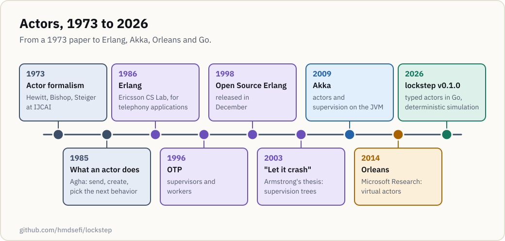
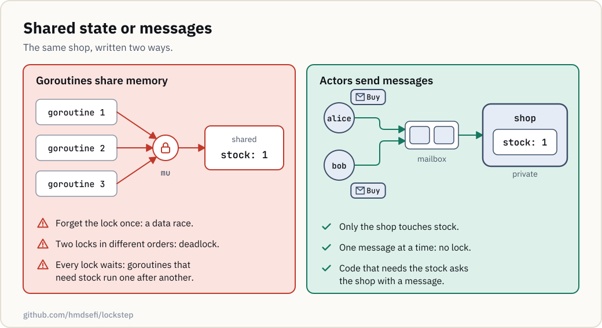
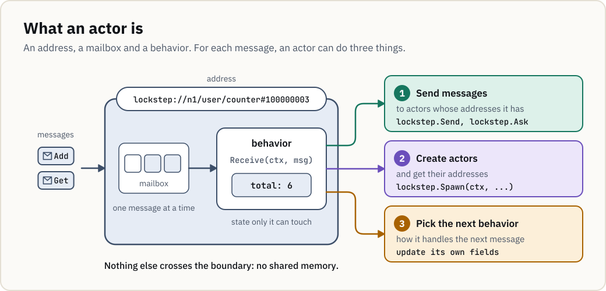
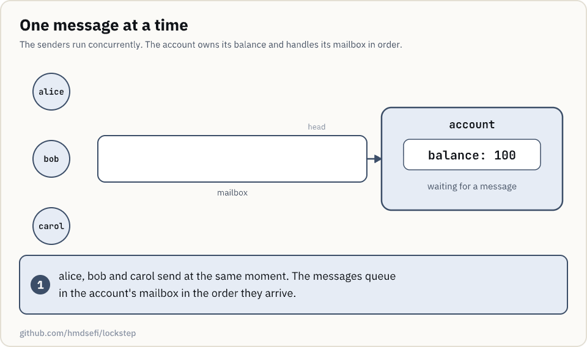

# The actor model

This page explains why lockstep actors share no memory, talk only by messages, and restart from a
factory when they fail. Those rules come from the actor model, which started as a theory in 1973
and grew up in telephone systems. You don't need this page to write your first actor; the
[README](../README.md) gets you there.

## Where actors came from

The actor model began as a theory of computation. Erlang, built for telephony by people who didn't
know that theory, arrived at a very similar design, and later frameworks took it to new runtimes.

  <picture>
    <source media="(prefers-color-scheme: dark)" srcset="assets/actor-model-timeline-dark.svg">
    
  </picture>

Actors that share nothing and talk by messages run through every entry; supervision arrives with
Erlang and OTP.

In 1973, Carl Hewitt, Peter Bishop and Richard Steiger presented
[A Universal Modular ACTOR Formalism for Artificial Intelligence](https://www.ijcai.org/Proceedings/73/Papers/027B.pdf)
at the International Joint Conference on Artificial Intelligence (IJCAI). Their formalism is based
on "a single kind of object: actors", and it defines everything an actor does as sending messages
to other actors. Gul Agha's [1985 MIT report](https://dspace.mit.edu/handle/1721.1/6952),
published as a book in 1986, gave the definition this page uses.

Joe Armstrong, Robert Virding and Mike Williams started Erlang at the
[Ericsson Computer Science Laboratory](https://www.erlang.org/faq/academic.html). Armstrong's
[history of Erlang](https://doi.org/10.1145/1238844.1238850) dates the work to 1986 and gives its
goal: "a better way of programming telephony applications". An Erlang program is many small
processes that share no memory and talk by messages. Armstrong said later, on a
[panel with Hewitt](https://www.erlang-solutions.com/blog/lets-talkconcurrency-panel-discussion-with-sir-tony-hoare-joe-armstrong-and-carl-hewitt/),
"I didn't know about the actor stuff at the time".

Ericsson started the Open Telecom Platform (OTP) project in 1996, a set of Erlang libraries, and
released Open Source Erlang in December 1998. Armstrong's 2003 thesis,
[Making reliable distributed systems in the presence of software errors](https://erlang.org/download/armstrong_thesis_2003.pdf),
describes the error-handling style behind OTP, "Let it crash", and the supervision trees that make
it work.

Jonas Bonér started Akka in 2009 (its
[first commit](https://github.com/akka/akka-core/commit/0a31ad718883ef0314de6dc8c6c2c9699eadfdae)
is from February that year). It brought actors and supervision to the Java Virtual Machine (JVM),
with Scala and Java APIs. In 2014, Microsoft Research described
[Orleans](https://www.microsoft.com/en-us/research/publication/orleans-distributed-virtual-actors-for-programmability-and-scalability/),
whose virtual actors are "purely logical entities that always exist, virtually": code never
creates or destroys them explicitly. lockstep actors are the opposite kind: you spawn and stop
each one.

## The problems actors answer

Actors start from a complaint about shared memory, and Erlang and Akka added answers for failures
and for distribution.

### Shared memory and locks

When several goroutines update the same variable, each must take a lock first. Forget it once and
you have a data race. Take two locks in different orders and two goroutines can wait for each
other forever; [Akka's docs](https://doc.akka.io/libraries/akka-core/current/typed/guide/actors-motivation.html)
say it plainly: "Locks introduce a new menace: deadlocks." Locks also make the goroutines that need
the same data run one after another.

  <picture>
    <source media="(prefers-color-scheme: dark)" srcset="assets/shared-state-vs-actors-dark.svg">
    
  </picture>

An actor removes the shared variable: the state belongs to one actor, and the rest of the program
reaches it by sending that actor a message.

Actors don't remove every concurrency bug. The order in which messages arrive still matters, and
[Why lockstep](why-lockstep.md) shows an actor that oversells stock because of it.

### Failures

Armstrong's thesis is about making reliable distributed systems in the presence of software
errors. Erlang's answer, which the thesis sums up as "Let it crash", is to stop handling
unexpected errors where they happen. The failing process crashes, and the thesis's rule takes
over: "Let some other process do the error recovery." In lockstep that other process is the
actor's parent, as [Supervision trees](#supervision-trees) shows.

### Distribution

An actor is known only by its address, so the code that sends a message doesn't depend on how the
message travels. Akka builds on this; its docs on
[location transparency](https://doc.akka.io/libraries/akka-core/current/general/remoting.html)
describe its functions as working the same in a single JVM or on a cluster. lockstep keeps
addresses but not the cluster, as [Where lockstep fits](#where-lockstep-fits) explains.

## How actors work

In practice an actor has an address, a mailbox, and a behavior with private state. Messages wait in
the mailbox until the actor takes them, one at a time.

  <picture>
    <source media="(prefers-color-scheme: dark)" srcset="assets/actor-anatomy-dark.svg">
    
  </picture>

For each message, an actor can send messages, create actors, and change how it handles the next
message. Nothing else crosses its boundary.

The parts work like this:

- *Address*: you can send a message only to an actor whose address you have. You get one by
  creating the actor or by receiving the address in a message. In lockstep the address is a
  typed `PID[M]`; its untyped form is `Address`.
- *Mailbox*: messages wait here in arrival order. Hewitt's
  [later papers](https://arxiv.org/abs/1008.1459) point out that the model itself doesn't need a
  mailbox, but practical systems add one. [Akka](https://doc.akka.io/libraries/akka-core/current/general/actors.html)
  gives each actor exactly one. lockstep gives each actor a user mailbox for its messages, plus a
  system queue for lifecycle signals.
- *Behavior and state*: the actor handles one message at a time, to completion, and only it reads
  or writes its state. In lockstep, changing that state is how an actor changes its handling of
  the next message.

Three users send an account actor a deposit and two withdrawals at the same moment. The order in
which they arrive decides who is declined:

  <picture>
    <source media="(prefers-color-scheme: dark)" srcset="assets/actor-mailbox-dark.gif">
    
  </picture>

The account needs no lock because it handles one message at a time, but its replies still depend
on the arrival order.

## Supervision trees

Actors that create other actors form a tree, and each parent supervises its children. When a child
fails, its parent decides what happens. Erlang/OTP's
[supervisor documentation](https://www.erlang.org/doc/system/sup_princ.html) defines two restart
strategies. `one_for_one` restarts only the failed child, and `one_for_all` restarts all of the
supervisor's children. A supervisor that restarts too often, past its restart intensity, stops its
children and then itself.

  <picture>
    <source media="(prefers-color-scheme: dark)" srcset="assets/supervision-restart-dark.gif">
    
  </picture>

A restart throws away the failed actor's state and builds it again with the *factory*, the
function you passed to `Spawn`, under the same address. Under one-for-one, its siblings keep
working.

lockstep takes OTP's two strategies as `OneForOne` and `AllForOne`. Its *directive*, the parent's
decision about a failed child, can also be resume or escalate, and restarts back off from 10 ms to
10 s. By default, past 10 restarts in a minute the directive becomes escalate. The
[architecture page](architecture.md#lifecycle-and-supervision) lists the details.

## Where lockstep fits

lockstep is the actor model in Go, with typed messages and a simulator:

- *Typed messages*: an `Actor[M]` receives one message type, and a `PID[M]` accepts only that
  type, so sending the wrong message is a compile error.
- *No goroutines in actor code*: time, randomness and I/O go through the runtime, as `ctx.Now`,
  `ctx.Rand`, and effects started with `lockstep.Do`. `lockstep-vet` reports actor code that starts
  goroutines, reads the wall clock or blocks.
- *Deterministic simulation*: the runtime owns every delivery, timer, random number and effect.
  So `lockstep/sim` can run the same actors in a simulated world, where a seed decides the message
  order, the latencies, and the crashes and partitions. Code that assumes one arrival order, like
  an account that expects the deposit first, is the kind of bug this finds. Each seed tries an
  order, and a failing seed replays exactly.

Location transparency is where lockstep is limited. A `PID` names the node its actor lives on, and
`lockstep/sim` delivers messages between nodes over a simulated network. lockstep has no remoting
or clustering, so outside `lockstep/sim`, actors on different nodes don't talk.

## Next steps

- [Why lockstep](why-lockstep.md): an ordering bug in an actor, found and replayed from a seed.
- [Architecture](architecture.md): how the runtime, its engines and the simulation are built.
