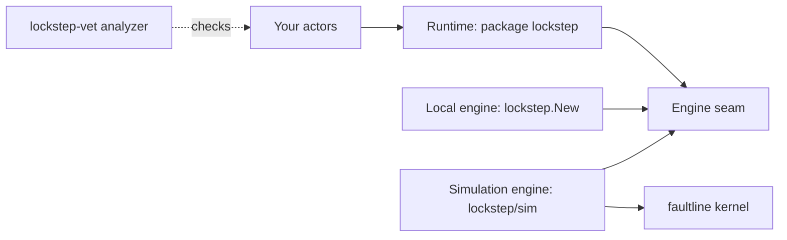

# lockstep architecture

This page explains how lockstep v0.1.0 is built: its parts, how a message moves through them, and
why the same actor code can run in your program and in a seeded simulation. To start using
lockstep, read the [README](../README.md) first.

## The parts

lockstep has a runtime, two engines that run it, and an analyzer. The runtime in package
`lockstep` holds everything an actor sees: systems, PIDs, mailboxes, supervision, timers, asks and
effects. It is written against a small internal interface, the engine seam. Two engines implement
the seam: the local engine behind `lockstep.New()`, and the simulation engine in `lockstep/sim`,
which runs on [faultline](https://github.com/hmdsefi/faultline).

Your actors never see which engine runs them.

## Nondeterminism goes through the runtime

A simulation can replay a run exactly only if nothing in it depends on the real world. lockstep
gets there by routing every source of nondeterminism in actor code through the runtime:

- Message delivery: the engine decides which actor runs next and in what order messages
  arrive.
- Time: `ctx.Now`, `ctx.After` and `ctx.Every` read the engine's clock, not the wall clock.
- Randomness: `ctx.Rand` returns a stream the engine owns.
- I/O: anything that waits, such as a network call or a file write, is an effect started with
  `lockstep.Do`, and the engine decides how it runs.

Actor code that follows this rule never starts goroutines, never blocks, and never reads
`time.Now` or global `math/rand`. `lockstep-vet` reports code that breaks it.

## Systems, actors and PIDs

A `*lockstep.System` holds the actors of one process, or of one node in a simulation. Every
system has two guardians: `/user`, the parent of actors spawned from the system, and `/system`,
for lockstep's own actors. An actor spawned from another actor's context is that actor's child.

An actor is a value that implements `Actor[M]`, where `M` is the one message type it accepts.
`Spawn` takes a factory, `func() Actor[M]`, and calls it at every start and every restart, so a
restart always begins from fresh state.

`Spawn` returns a `PID[M]`. A PID is a comparable value that names one spawned actor, across its
restarts: its node, its path, and a 64-bit `uid` unique per spawn on that node. Its string form is
`lockstep://<node><path>#<uid>`, with the `uid` in hexadecimal. A restart keeps the PID. Stopping an actor and spawning a new one
with the same name gives a new `uid`, so old PIDs never reach the new actor.

## Messages and mailboxes

`Send[M]` delivers only `M` values to a `PID[M]`, so the compiler rejects a message of the wrong
type. The usual message type is a sealed interface: an interface with an unexported marker
method, implemented by a fixed set of structs.

Local delivery passes the message as it is, without copying it. A message is safe to send when it
holds no pointers, slices, maps, channels or functions, or when the sender never touches it again
after `Send`.

Each actor has two queues:

- The *user mailbox* holds `M` messages. It is bounded: 1024 sent messages by default, set per
  actor with `WithMailbox` or per system with `WithDefaultMailbox`. Timer messages, replies that
  `lockstep.Pipe` turns into messages, and effect results are never refused and do not count
  toward the capacity.
- The *system queue* holds lifecycle commands and signals. It is processed first and is not
  limited by the mailbox capacity, so supervision works even when the user mailbox is full.

When the user mailbox is full, its policy decides what happens. `FailSend`, the default, returns
`ErrMailboxFull`. `DropNewest` and `DropOldest` drop a message and trace it. `BlockSender` makes a
sender outside the system wait for room; for a sender inside an actor, and in simulation, it acts
as `FailSend`.

Messages from one sender to one receiver arrive in send order, on one node and across nodes.
There is no order across different senders. A message to an actor that has stopped becomes a
*dead letter*: it is traced and counted, and `Send` returns nil, because the sender cannot know
whether the message was already in flight.

## Requests and replies

`Ask` sends a request that carries a typed `ReplyTo[R]` and returns a `*Reply[R]`. The reply
resolves once, with the first of an answer, a failure, a timeout (5 seconds by default), or
`ErrTerminated` when the asked actor stops without answering.

Code outside actors waits with `Reply.Await`. An actor never waits: `lockstep.Pipe` delivers the
reply to it as one of its own messages. `Await` during an actor's turn returns `ErrAwaitInActor`,
and in simulation it fails the seed.

## Turns

A *turn* is one engine call that processes messages for one actor: its system queue first, then
user messages up to a budget the engine passes in. An actor handles one message at a time, so its
fields need no lock.

The budget is where the two engines differ most. The local engine passes 32, so a busy actor
yields after 32 messages. The simulation engine passes 1, so every delivery is a separate event
and each seed can order deliveries to different actors differently.

## Lifecycle and supervision

An actor starts, runs, and stops. Starting calls the factory, then `Started` if the actor
implements `Starter[M]`, and only then delivers user messages.

`Stopped` runs exactly once per incarnation: on a stop, before every restart, and after a failure.
It does not run when a simulated node crashes, because a crash discards the whole system. Its
`StopReason` says why the actor stopped. Resources registered with `ctx.Own` are closed after `Stopped` returns,
in reverse order. A stopping actor stops its children first, so no actor outlives its parent.

A panic in `Receive`, or a call to `ctx.Fail`, marks the actor failed. Its parent's strategy then
picks a directive: restart, stop, resume (drop the message and keep the state), or escalate (the
parent fails with the child's error). `OneForOne` applies the directive to the failed child and
`AllForOne` to all of the parent's children. Both allow 10 restarts per minute and back off from
10 ms to 10 s between restarts, measured on the engine's clock, so simulation runs the backoff in
virtual time. Past the limit, the directive becomes escalate. Watchers registered with `Watch`
receive a `Terminated` signal when the actor stops for good.

## Effects

An effect is a value with a stable `Name()` and a `Run(ctx)` method that does the real work.
`lockstep.Do` starts it and returns at once. When it finishes, the `done` function you pass
builds a message from its result, and that message arrives in the actor's mailbox. Each effect
has a 30 second timeout by default, after which `done` receives `ErrTimeout`. Effects started by
an incarnation are cancelled when it stops or restarts.

The engines run effects in different ways:

- Local engine: `Run` runs on its own goroutine, at most 64 at a time. Up to 1024 more wait in a
  queue; past that, `done` receives `ErrOverloaded`.
- Simulation engine: `Run` is never called, because real I/O cannot replay. The test registers
  a handler per effect name with `s.HandleEffect`. The handler returns a value, an error and a
  simulated latency, and can draw them from the run's seeded random stream. An effect with no
  handler fails the seed.

## The local engine

`lockstep.New()` builds a system on the local engine. One loop goroutine runs every turn, every
timer callback and every effect completion. Actors interleave on that goroutine but never run in
parallel. Effects are the only work that runs on other goroutines.

The local engine reads the wall clock and seeds each actor's random stream from `crypto/rand`. It
has no transport to other processes, so actors on different nodes talk only in simulation.

## The simulation engine

`sim.Simulate` wraps `faultline.Run`. Each seed is a subtest, and each run gets a fresh world with
virtual time and a simulated network. Inside it, lockstep maps its decisions onto faultline's
kernel:

- A turn is one kernel event on the actor's node.
- A timer is a kernel timer on the node's local clock, which faultline can skew and jump.
- A send to another node goes through faultline's simulated network. lockstep makes the links
  first-in, first-out, numbers the messages of each sender and receiver pair, and treats a gap as
  a loss, so faults can drop and partition but never reorder within a pair.
- An effect calls its handler in a kernel event and delivers the result after the handler's
  latency.
- `ctx.Rand` returns the faultline stream `lockstep/<node>/<epoch>/<path>/<incarnation>`, so each
  actor's randomness depends only on the seed and on who it is.
- `s.Node(name, setup)` adds a server node. Each boot builds a new system and runs `setup`. A
  crash discards the system, and a restart boots a new one.

Every runtime decision also emits a kernel record named `lockstep.<event>`, such as
`lockstep.send`, `lockstep.turn` or `lockstep.restart`. faultline writes them to `trace.jsonl` and
hashes them into the run's trace hash, so a replay that matches the hash made the same decisions
in the same order.

### Faults

Faults come from two places. faultline's planners crash, restart and pause nodes, partition the
network, and make links lossy or slow. lockstep adds actor-level faults, which replay exactly from
the seed like the rest of the run:
`s.InjectFail` fails one actor, `s.StopActor` stops one, `s.DelayBetween` and `s.DropBetween`
delay or drop messages between two actors, and `s.Pressure` simulates memory pressure on a node.

### Checks

On top of the checks your test registers, `sim` fails a seed through four named faultline checks:

- `lockstep/deadlock`: the world is idle and pending asks form a cycle. The failure text starts
  with `lockstep: deadlock:` and lists the actors in the cycle. lockstep builds a wait-for graph of the
  asks and finds the cycle with [gograph](https://github.com/hmdsefi/gograph).
- `lockstep/leak`: an incarnation ended with an effect still pending, or a resource it owns failed
  to close.
- `lockstep/no-effect-handler`: an actor started an effect that has no handler.
- `lockstep/misuse`: actor code broke a runtime rule, such as calling `Await` during a turn.

## Overload

Every system has an actor cap: 1,000,000 live actors by default, set with `WithMaxActors`. Past
it, `Spawn` returns `ErrActorCap`. One percent of the cap is kept for restarts and system actors,
so supervision keeps working at the cap.

In simulation, `sim.Options.Budget` caps live actors and their estimated memory in bytes, and
`s.Pressure` turns memory pressure on and off. While either applies, `Spawn` returns
`ErrOverloaded`, sends to user actors are refused as if their mailboxes were full, and actors that
called `ctx.SubscribeOverload` receive an `Overloaded` signal. The local engine does not read the
live heap, so `WithAdmission` has no effect there; see [Limitations](../README.md#limitations).

## Static analysis

`lockstep-vet` lives in the nested module `github.com/hmdsefi/lockstep/analysis`, because it needs
`golang.org/x/tools`, and the root module requires only faultline, gograph and, for tests,
`go.uber.org/goleak`. It
finds actor code by its `Receive`, `Started`, `Stopped` and `Signal` methods and follows the calls
they make inside the same package. Its checks are:

- `LS100`: wall-clock time, global `math/rand`, `crypto/rand`, goroutines, `select`, channel
  operations, map ranges, environment reads and blocking calls in actor code.
- `LS110`: `Reply.Await` reachable from actor code.
- `LS001` and `LS002`: malformed and unknown `//lockstep:` directives.

`LS100` ports most of faultline's determinism rules to actor code and adds the blocking calls.
The same analyzers run in golangci-lint as a
module plugin.

## Modules and the production boundary

The repository holds three Go modules:

- `github.com/hmdsefi/lockstep`, the root module: the runtime, `sim`, and internal packages for
  the engine seam, the local engine, mailboxes, supervision, the registry and overload state.
- `github.com/hmdsefi/lockstep/analysis`: `lockstep-vet` and the golangci-lint plugin.
- `github.com/hmdsefi/lockstep/examples/raft`: the Raft example.

Only `sim` imports faultline. A program that imports `lockstep` and not `sim` never links
faultline or gograph; CI checks this with `go list -deps` over the production packages. faultline and gograph
still appear in your `go.mod`, because the root module requires them for `sim`.

lockstep's own simulation path follows faultline's determinism rules, and CI checks it in three
ways. Setting `LOCKSTEP_CHECK_DETERMINISM=1` runs every simulation test twice and compares the
trace hashes. Small actor systems have golden trace hashes pinned in the repository. A lint
reports goroutines, wall-clock reads and unsorted map iteration in the runtime packages that the
simulation calls.

## Next steps

- [Why lockstep](why-lockstep.md): the problem lockstep solves and when to use it.
- [The Raft example](../examples/raft/README.md): a larger lockstep program under partitions and
  crashes.
- [Package documentation](https://pkg.go.dev/github.com/hmdsefi/lockstep): the full API.
